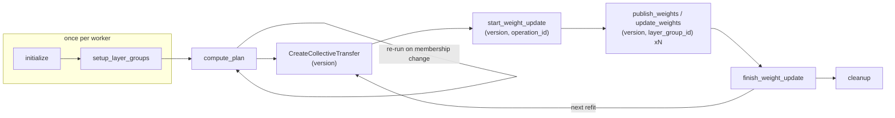
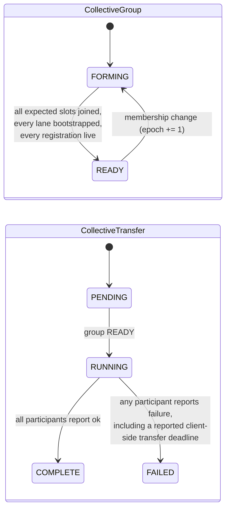

<!--
SPDX-FileCopyrightText: Copyright (c) 2026 NVIDIA CORPORATION & AFFILIATES. All rights reserved.
SPDX-License-Identifier: Apache-2.0
-->

# NCCL M2N Refit: collective weight transfer, standalone from NIXL

> **Status: implemented in this PR (ai-dynamo/modelexpress #748).** Separate
> from the NIXL pull path in
> [`modelexpress_rl/refit/reshard/`](rl/ARCHITECTURE.md#no-gather-refit-resharding);
> neither path imports the other.

Part 1 is the client API that integrators code against; we intend to keep it
stable. Part 2 is how MX implements that API and can change without notice.

## Part 1: Client API

### Overview

Package: `modelexpress_rl.collective`. Per side, an integrator:

- implements one engine adapter: `Publisher` on the trainer, `Loader` on the
  generator;
- builds one `CollectiveRendezvous` per worker process on a gRPC channel to MX;
- calls the lifecycle client, `RefitClientTrainer` or `RefitClientGenerator`,
  from the RL framework's actor RPCs, with the same `version` and
  `operation_id` on all participants.

This PR ships no Megatron `Publisher` or vLLM `Loader`; the integration provides
them. NeMo RL's existing builders port directly to the `LocalParamSpec` SPI.

### `CollectiveRendezvous`

```python
CollectiveRendezvous(
    channel: grpc.Channel,
    *,
    rpc_timeout_s: float = 30.0,
    registration_ttl_s: int | None = None,
)
```

One per worker process. Registers the worker with MX and renews its liveness
lease on a background thread. `registration_ttl_s=None` reads
`MX_NCCL_REFIT_REGISTRATION_TTL_S`. `close()` stops renewal; the instance is
also a context manager. The refit clients do not close it.

### `RefitClientTrainer` and `RefitClientGenerator`

Constructor, the same for both classes (all arguments keyword-only):

```python
RefitClientTrainer(
    *,
    rendezvous: CollectiveRendezvous,
    model_name: str,
    trainer_slots: list[str],
    generator_slots: list[str],
    source_partition_count: int,
    slot_id: str,
    worker_id: str,
    index_in_role: int,
    receiver_protocol: str = DEFAULT_RECEIVER_PROTOCOL,  # "mx-nccl-m2n-bootstrap-v1"
    m2n_abi_version: str = "",
    device: Any = None,
    streams: list[Any] | None = None,
)
```

- `trainer_slots`, `generator_slots`: all slot ids in the group, in rank
  order. The same on all participants.
- `source_partition_count`: number of reshard lanes, typically the trainer PP
  size. Must divide `len(trainer_slots)`; lane `i` gets the `i`-th contiguous
  block of trainer slots.
- `slot_id`: this worker's seat. `index_in_role`: position of `slot_id` in its
  role's slot list. `worker_id`: this process generation; use a new id after a
  restart.
- `receiver_protocol`, `m2n_abi_version`: part of the plan digest; must match
  on all participants. An empty `m2n_abi_version` is replaced by the installed
  distribution that ships `nccl.m2n` (for example `nccl-extensions==X.Y.Z`),
  so peers on different builds do not agree on a digest by default.
- `MX_NCCL_REFIT_BLOCKING_DATA_PLANE`, `MX_NCCL_REFIT_GROUPED_SUBMISSION`:
  read once when the client is constructed and part of the plan digest, since
  both change what a rank does inside native collectives. The client runs the
  values it hashed, so changing the environment afterwards has no effect.
- `device`: CUDA device for the communicators; `None` uses the current device.
- `streams`: lane `i` runs on `streams[i % len(streams)]`. `None` or empty
  runs all lanes on the current stream.

Trainer methods, in call order:

```python
def initialize(self, publisher: Publisher, *, source_partition: int, expected_parameters: list[str] | None = None) -> None
def setup_layer_groups(self, groupings: list[list[str]] | None) -> None
def compute_plan(self) -> Membership
def create_operation(self, version: str, *, key_prefix: str) -> str
def start_weight_update(self, version: str, operation_id: str) -> None
def publish_weights(self, version: str, layer_group_id: int = DEFAULT_LAYER_GROUP) -> None
def finish_weight_update(self, version: str, *, operation_id: str | None = None) -> None
def retry_report(self) -> None
def report_failure(self, operation_id: str, error: BaseException, *, membership: Membership | None = None) -> None
def cleanup(self) -> None
```

Generator methods, in call order:

```python
def initialize(self, loader: Loader, *, expected_parameters: list[str] | None = None) -> None
def setup_layer_groups(self, groupings: list[list[str]] | None) -> None
def compute_plan(self) -> Membership
def create_operation(self, version: str, *, key_prefix: str) -> str
def start_weight_update(self, version: str, operation_id: str) -> None
def update_weights(self, version: str, layer_group_id: int = DEFAULT_LAYER_GROUP) -> None
def finish_weight_update(self, version: str, *, operation_id: str | None = None) -> None
def retry_report(self) -> None
def cleanup(self) -> None
```

Both classes also expose read-only properties `membership: Membership` (after
`compute_plan`) and `plan: ReshardPlan` (after `initialize`).
`DEFAULT_LAYER_GROUP` is `0`.

- `initialize`: once per worker. Captures the plan from the engine and checks
  that it covers `expected_parameters`, or `parameter_names()` when omitted.
  The trainer's `source_partition` must be the reshard lane that holds
  `slot_id`.
- `setup_layer_groups`: optional, before `compute_plan`. `groupings[i]` lists
  the bulk parameter names of layer group `i`; groups must be disjoint and
  the same on all participants. Without it all bulk parameters are in group
  `0`.
- `compute_plan`: after `initialize` on every worker. Joins the MX group, waits
  for READY, and creates the communicators. Re-run after any error that moves
  the epoch.
- `create_operation`: once per refit, before `start_weight_update`. Returns the
  `operation_id` for `version` at the current epoch. Idempotent per
  `(key_prefix, group, epoch, version)`, so each participant can call it and
  get the same id. A coordinator can instead create the id once and pass it
  out.
- `start_weight_update`: opens the round. Checks the operation against this
  worker's group, epoch, model and `version` before any NCCL work, then calls
  the engine's `start_new_round(version)`. One open round at a time.
- `publish_weights` / `update_weights`: once per layer group per round, in the
  same group order on all participants. The generator installs groups as they
  arrive, keeping up to `MX_NCCL_REFIT_PIPELINE_DEPTH` in flight.
- `finish_weight_update`: closes the round. Runs the misc broadcast, installs
  the remaining groups and calls `Loader.finish()` (generator), and reports
  success to MX. `operation_id`, if given, must equal the bound one. The
  success report is retried on UNAVAILABLE and DEADLINE_EXCEEDED (3 attempts
  in all). If it still does not land, the error is raised and the round stays
  bound to its operation.
- `retry_report`: resends a success report that `finish_weight_update` could
  not deliver, then releases the binding. Until it succeeds, the next
  `start_weight_update` is refused. `cleanup` reports such a round FAILED.
- `report_failure` (trainer only): reports `operation_id` FAILED for a failure
  outside the client's own round calls. `membership` defaults to the current
  one.
- `cleanup`: terminal. Calls the engine's `cleanup()`, fails any open round,
  and tears down the communicators.

A round call that raises after `start_weight_update` has bound the operation
has already aborted the group's lanes, reported the operation FAILED (best
effort) and reset the round. The caller re-runs `compute_plan` before the next
round.

### Engine SPI

The trainer implements `Publisher`; the generator implements `Loader`. Both are
`runtime_checkable` `typing.Protocol` classes.

```python
class Publisher(Protocol):
    def capture(self) -> ReshardPlan: ...
    def parameter_names(self) -> list[str]: ...
    def local_params(self) -> dict[str, LocalParamSpec]: ...
    def start_new_round(self, version: str) -> None: ...
    def cleanup(self) -> None: ...

class Loader(Protocol):
    def capture(self) -> ReshardPlan: ...
    def parameter_names(self) -> list[str]: ...
    def local_params(self) -> dict[str, LocalParamSpec]: ...
    def start_new_round(self, version: str) -> None: ...
    def install(self, layer_group_id: int) -> None: ...
    def finish(self) -> None: ...
    def cleanup(self) -> None: ...
```

- `capture`: returns the plan: names, global shapes, dtypes, meshes,
  placements, partitions. Both sides must produce the same plan.
- `parameter_names`: the complete canonical parameter set the plan must cover.
- `local_params`: maps each declared name to this rank's storage.
- `start_new_round`: prepares the engine for one refit; a Publisher may stage
  weights here.
- `install` (Loader): commits one layer group's received buffers into the live
  model.
- `finish` (Loader): refreshes derived state after all groups are installed.
- `cleanup`: releases engine-side resources.

`local_params` values are `LocalParamSpec` records; hooks exchange a
`RefitCtx`:

```python
@dataclass
class LocalParamSpec:
    base: Any = None
    pre: Callable[[Any], RefitCtx] | None = None
    post: Callable[[RefitCtx], None] | None = None

@dataclass
class RefitCtx:
    buf: Any
    extra: dict[str, Any] = field(default_factory=dict)
```

- `base`: the live local tensor, sent from or received into directly.
- `pre`: called with `base`; returns a `RefitCtx` whose `buf` the wire op uses.
  Needed when `base` is `None`.
- `post`: called with that `RefitCtx` after the wire op; commits the bytes.
- `RefitCtx.extra`: free-form state from `pre` to `post`, such as the fused
  parameter slice a received tile belongs to.

`pre`, the wire op and `post` run on one CUDA stream. Section 6.1 lists the
common patterns.

### Call sequence for one refit round

The flowchart in section 2.B shows the same order.

1. Once per worker: `initialize`, then optionally `setup_layer_groups`.
2. Every worker: `compute_plan`. All workers must return from it before any
   worker calls `start_weight_update`.
3. Per refit: `create_operation(version, key_prefix=...)` on each participant,
   or once by a coordinator that hands out the id.
4. Every participant: `start_weight_update(version, operation_id)`.
5. For each layer group, in the same order everywhere: trainer
   `publish_weights(version, layer_group_id)`, generator
   `update_weights(version, layer_group_id)`.
6. Every participant: `finish_weight_update(version)`. Repeat from step 3 for
   the next refit; repeat from step 2 after an epoch change.
7. Terminal: `cleanup()`, then `CollectiveRendezvous.close()`.

### Errors a caller must handle

`GroupNotReadyError`, `EpochChangedError` and `TransferBindingError` subclass
`RendezvousError`.

| Exception | Raised from | Meaning | Caller action |
|---|---|---|---|
| `GroupNotReadyError` | `compute_plan` | Group missed READY within `MX_NCCL_REFIT_GROUP_TIMEOUT_S`; `.missing` names the slots still absent | Fix or restart the missing slots, then retry `compute_plan` |
| `EpochChangedError` | `compute_plan`, `start_weight_update` | Membership or plan digest moved the epoch; `.disagreeing` names slots with a different plan digest | Re-run `compute_plan` (after fixing the plan if `.disagreeing` is set) |
| `TransferBindingError` | `start_weight_update` | The operation does not match this worker's group, epoch, model or `version`, or is no longer PENDING or RUNNING | Create a new operation at the current epoch |
| `RendezvousError` | any client call | Other control-plane failure, including a group no longer READY or a superseded slot | Re-run `compute_plan` |
| `PlanCoverageError` | `initialize`, `compute_plan` | The captured plan does not partition the expected parameter set | Fix the engine adapter |
| `NcclUnavailableError` | `compute_plan` | `nccl4py` or `nccl-extensions` is missing or too old | Install the dependencies in section 10 |
| `CommunicatorWedgedError` | `publish_weights`, `update_weights`, `finish_weight_update`, `cleanup` | A lane abort overran `MX_NCCL_REFIT_ABORT_TIMEOUT_S`; the round is already reported FAILED | Exit the process with a non-zero `os._exit` (section 8.2) |

Any other exception from a round call is a transport or timeout failure; the
round is already aborted and reported, so re-run `compute_plan`.

A failure while `compute_plan` bootstraps the communicators (lane init, the
post-init settle, or the bootstrap barrier) is fatal for the worker instead.
The local communicators are aborted and the rendezvous is closed: the worker's
lease stops renewing, so its TTL moves the epoch off the bootstrap ids just
aborted, and any later `compute_plan` on that client raises `RendezvousError`
rather than rejoin it. Restart the worker process; it joins the next epoch.

### Configuration

Defaults and details are in section 9.

- `MX_NCCL_REFIT_NUM_STREAMS`: stream pool size for integrations that build
  their own `streams`.
- `MX_NCCL_REFIT_BLOCKING_DATA_PLANE`: run data traffic on a blocking
  communicator (on by default).
- `MX_NCCL_REFIT_GROUPED_SUBMISSION`: record each layer group's reshards in one
  `nccl.m2n.group()`.
- `MX_NCCL_REFIT_PIPELINE_DEPTH`: layer groups the generator keeps in flight.
- `MX_NCCL_REFIT_RECEIVE_WINDOW_BYTES`: bound on the receive scratch one layer
  group keeps alive on the per-call path.
- `MX_NCCL_REFIT_SEND_WINDOW_BYTES`: the same bound on the trainer's send
  scratch (buffers a `pre` hook builds, such as stacked grouped experts).
- `MX_NCCL_REFIT_GROUP_TIMEOUT_S`: deadline for `FORMING -> READY`.
- `MX_NCCL_REFIT_POLL_INTERVAL_S`: group poll backoff floor.
- `MX_NCCL_REFIT_COMM_INIT_TIMEOUT_S`: deadline for one lane's communicator
  init.
- `MX_NCCL_REFIT_TRANSFER_TIMEOUT_S`: client-side transfer deadline. It is
  checked between submissions, so a submission that blocks the host is not
  bounded by it (section 8.2).
- `MX_NCCL_REFIT_ABORT_TIMEOUT_S`: one shared bound on tearing down every lane
  of a group before `CommunicatorWedgedError`.
- `MX_NCCL_REFIT_REGISTRATION_TTL_S`: worker liveness lease lifetime.

## Part 2: Internal design

## 1. What this is

A second, independent ModelExpress (MX) refit data plane: a **sender-driven NCCL
collective push** built on `nccl.m2n.reshard`. Trainer and generator ranks enter
one collective call, and NCCL performs the M-to-N redistribution between the two
parallelism meshes. The existing plane is a **receiver-driven NIXL pull**, in
which each generator rank READs the byte ranges its layout needs.

| | NIXL pull (existing) | NCCL M2N push (this document) |
|---|---|---|
| Initiator | Generator rank | Both sides co-call; the trainer supplies bytes |
| Wire primitive | One-sided RDMA `READ` | `nccl.m2n.reshard` collective |
| Who routes | The MX receiver plans byte runs | NCCL routes from the src/dst meshes |
| Membership | Each receiver joins independently | Fixed communicator; every member must enter |
| MX control-plane role | Shard and manifest directory, leases | Rendezvous, admission, fencing, group state |
| Source lifetime | Buffers must outlive the receivers | Buffers live only across the collective |
| Partial generator set | Receivers are independent | Requires a per-operation admitted group (section 5) |

Pull tolerates ragged membership and late joiners. Push uses NCCL's tuned M-to-N
kernels and does not keep trainer buffers registered and pinned between refits.

### Non-goals

- No NIXL fallback, no runtime transport ranking, no "try NCCL then NIXL". One
  deployment configures one backend.
- No public layer or tensor selection API beyond
  `layer_group_id`.
- No change to the existing `RefitService` pull RPCs (`WeightVersionShard`,
  `VersionLease`, `RefitWorkerService`).

## 2. Design inputs

### A. Requirements

1. Source trainer ranks push **only after the destination generator ranks have
   joined and exposed prepared destinations.**
2. **MX manages an ephemeral collective transfer group per operation**:
   participant worker generations, source and destination roles, communicator
   bootstrap information, fencing, and operation state.
3. **Workers ask MX to join an operation; they do not choose or create groups.**
4. The RL framework invokes the selected generators and the trainer through its
   native actor RPCs with the same version and operation reference. **Trainer
   clients launch the collective only when MX reports the group READY.**
5. This needs an **additive collective-operation API**; the generator-initiated
   pull call is insufficient because a trainer cannot safely push to unknown or
   unprepared generators.
6. The TransferPlan's NCCL form carries collective membership and prepared
   destination bindings. Layer grouping stays internal.

### B. Client API layering

`RefitClient.Trainer` and `RefitClient.Generator` each split into a pluggable
**Publisher** (trainer) / **Loader** (generator) and a **ShardRedistribution
Backend** with `Sender` and `Receiver` halves. The lifecycle and sequencing
rules are fixed. `NCCL M2N backend` is listed under **Push mode options**,
opposite the NIXL pull backend.



### C. NeMo RL `nccl_reshard_refit`

NVIDIA-NeMo/RL PR #2971 (merged 2026-07-29). MX adopts its wire contract, so
MX-brokered and NeMo-RL-native deployments move identical bytes:

- The only wire op is `nccl.m2n.reshard` from **nccl4py**. `xferdtensor`'s
  pure-Python and golden paths are debugging aids outside the contract.
- Parameters are keyed by **HuggingFace names** with **global shapes**;
  per-expert MoE weights are grouped into one
  `...experts.{gate,up,down}_proj.weight` entry of shape `[E, ...]`.
- Layouts are a **rank mesh** plus DTensor **`Shard(dim)` / `Replicate()`**
  placements.
- Communicators are **per trainer PP stage**: stage `s`'s trainer ranks, then
  all participating generator ranks.
- **Bulk/misc split**: FFN projection weights (97-98% of the bytes on large MoE
  models) are resharded; the rest goes in a packed broadcast over a separate
  all-participants communicator.

Where MX differs:

| Concern | NeMo RL today | MX (this design) |
|---|---|---|
| Rendezvous | `StatelessProcessGroup` over a raw `TCPStore`, at an IP/port the Ray driver allocates per PP stage | MX control plane brokers the NCCL `uniqueId` |
| Rank assignment | Computed in the driver, hardcoded "train first, gen after" | MX assigns and returns `rank_in_lane`; same ordering rule, enforced server-side |
| Membership | Always *all* generator ranks | Per-operation admitted set |
| Fencing | None; a restarted worker silently rejoins | The `worker_id` generation is admitted or rejected; a membership change bumps the group epoch |
| Readiness | Implicit: everyone calls `init_nccl_communicator` and blocks | Explicit `FORMING -> READY` state the trainer waits on before launching |
| Group lifetime | One communicator for the whole job | Membership-keyed group, reused across refits, invalidated on epoch change |

## 3. Component architecture


- **RL framework**: picks the version and the refitting generator replicas;
  invokes both sides with the same `(version, operation_id)`.
- **MX control plane**: group identity, admission, rank assignment, NCCL
  `uniqueId`, worker-generation fencing, `FORMING -> READY` state.
- **RefitClient.Trainer / .Generator**: lifecycle, layer groups, local plan.
- **Publisher / Loader**: engine-specific mapping of each HF name to a local
  tensor, plus any staging to send or install it.
- **ShardRedistribution Backend (nccl_m2n)**: communicators and wire ops; the
  only component that imports `nccl`.

## 4. Rendezvous: what MX replaces

NeMo RL's `StatelessProcessGroup` is a `TCPStore` that moves the 128-byte
`ncclUniqueId` from rank 0 to the others, once per PP stage, at an address the
Ray driver allocates and passes to both actor sets. MX (authenticated,
TTL-backed, already connected to both sides) replaces it, removing the port
allocation and adding explicit membership, admission, fencing, and a readiness
state the trainer can observe.


Ordering. `CreateCollectiveTransfer` carries the `expected_epoch` the caller
saw `READY` (0 is rejected as INVALID_ARGUMENT) and is admitted only if, in the
same atomic step that opens the operation, the group is still `READY` at
exactly that epoch; otherwise it fails with FAILED_PRECONDITION and leaves no
operation and no idempotency reservation behind. First formation: `compute_plan` on
every worker (join, `READY`, communicators), then `CreateCollectiveTransfer`,
then `start_weight_update`. Later refits: create the operation, then
`start_weight_update`. A group epoch has at most one operation in flight
(PENDING or RUNNING): a create under a different idempotency key is refused
with FAILED_PRECONDITION naming the operation in flight, while a replay of the
same key returns that operation. An abandoned operation is cleared by
reporting it FAILED, or by the next epoch change.

`start_weight_update(version, operation_id)` reads the operation with
`GetCollectiveTransfer` and raises `TransferBindingError`, before preparing the
engine or issuing NCCL work, unless it names this worker's group, its admitted
epoch, the joined model and `version`, and is `PENDING` or `RUNNING`. The round
reports success or failure against that operation, so a transfer cannot complete
another version's operation, and an operation from before a membership change
fails at start. Creation is idempotent on the replay key (group, epoch, version),
so every participant may call `create_operation(version, key_prefix=...)` before
`start_weight_update` and get the same operation, with no id distribution.

## 5. Control plane

New proto file `modelexpress_common/proto/refit_collective.proto` and service
`RefitCollectiveService`, in their own Rust module; the pull and push paths share
no types.

### 5.1 Resources

| Resource | Lifetime | Owner |
|---|---|---|
| `CollectiveGroup` | Membership-keyed; reused across refits; `epoch` bumps on membership change | MX |
| `CollectiveLane` | One per group per communicator (per trainer PP stage, plus one broadcast lane) | MX |
| `CollectiveTransfer` | One per refit operation; references `(group_id, epoch)` and a `version_id` | MX |

Operations are per-refit and cheap; groups and their communicators are reused
until membership changes, which invalidates the communicator. Clients cache the `Communicator` under
`(group_id, epoch)` and drop it when the epoch changes.

### 5.2 Lanes

One `CollectiveGroup` has several communicators, for two spans:

| Lane kind | Count | Span | Carries |
|---|---|---|---|
| `LANE_KIND_RESHARD` | caller's choice, typically one per PP stage | the trainer slots that stage declares + all admitted generator ranks | `nccl.m2n.reshard` bulk params |
| `LANE_KIND_BROADCAST` | at most 1 | All admitted trainer + generator ranks | Packed misc-param broadcast |

The client declares each lane's membership in rank order; MX does not derive
lanes from `trainer_pp_size`. MX checks only structure: unique lane ids, existing
slots, no slot twice on one lane, every expected slot on some lane, at most one
broadcast lane, a trainer slot in every lane.

This is NeMo RL's `pp_comm_group` / `model_update_group` split. The misc
broadcast must run strictly after the bulk reshard: its lane overlaps every
reshard lane, and concurrent traffic on overlapping communicators can deadlock.

### 5.3 Rank assignment

`rank_in_lane` is the slot's **position in the lane the caller declared**:
trainer slots in declared order, then generator slots in declared order.

```text
lane     world_size = len(trainer_slots) + len(generator_slots)
  trainer  at declared position i   ->  rank_in_lane = i
  generator at declared position g  ->  rank_in_lane = len(trainer_slots) + g
```

Declaration order sets the convention (for NeMo RL, one reshard lane per PP
stage with that stage's trainer ranks). MX needs no TP/EP/DP knowledge; all
parallelism semantics stay client-side (section 6).

`rank_in_lane == 0` is always a trainer, since every lane has a trainer slot. It
generates and posts the lane's `ncclUniqueId`.

### 5.4 States



`READY` requires **all three** of: every expected slot has an admitted
participant; every lane has a posted `nccl_unique_id`; every admitted
participant's `WorkerRegistration` is unexpired. The registration check (the
counterpart of NIXL lease renewal) runs at admission and again at `READY`,
because a dead peer hangs the collective where NIXL would return `NOT_FOUND`.

### 5.5 RPCs

```protobuf
service RefitCollectiveService {
  // Orchestrator-facing.
  rpc CreateCollectiveTransfer(CreateCollectiveTransferRequest) returns (CollectiveTransfer);
  rpc GetCollectiveTransfer(GetCollectiveTransferRequest) returns (CollectiveTransfer);
  rpc DeleteCollectiveTransfer(DeleteCollectiveTransferRequest) returns (CollectiveTransfer);

  // Worker-client-facing. Workers join; they never create a group.
  rpc JoinCollectiveGroup(JoinCollectiveGroupRequest) returns (CollectiveGroupMembership);
  rpc GetCollectiveGroup(GetCollectiveGroupRequest) returns (CollectiveGroup);
  rpc PublishGroupBootstrap(PublishGroupBootstrapRequest) returns (CollectiveGroup);
  rpc ReportCollectiveTransfer(ReportCollectiveTransferRequest) returns (CollectiveTransfer);
}

// Worker-to-worker, reserved. A trainer coordinator would serve the reshard
// plan and MX would store only its digest and endpoint, as the pull path does
// for manifests. The in-tree clients capture the plan locally instead.
service RefitCollectiveWorkerService {
  rpc GetReshardPlan(GetReshardPlanRequest) returns (GetReshardPlanResponse);
}
```

There is no `AwaitGroupReady` RPC. Clients poll `GetCollectiveGroup` with
backoff, so a stalled peer surfaces as a client-side deadline that includes the
group's participant list.

### 5.6 Why the plan is worker-served

The reshard plan (section 6) has one record per bulk parameter (HF name, global
shape, dtype, source and destination mesh and placements, PP stage): hundreds of
entries and hundreds of kilobytes for a large MoE model. The pull path's rule
applies: the full sealed manifest stays worker-served so CRD or
etcd records stay small, and `manifest_digest` verifies fetched content.

The group reserves `plan_source = {worker_id, endpoint, digest}`, and
`RefitCollectiveWorkerService` lets a generator fetch and verify the plan from
the trainer coordinator. In-tree clients do not use this yet; each side captures
the plan from its own engine and MX compares digests at `READY` (section 8). The
plan depends on `(model layout, trainer parallelism, admitted generator set)`,
not the weights, so it is keyed by `(group_id, epoch)` and agreed **once per
epoch**.

## 6. The plan: mesh and placement contract

NeMo RL's contract, unchanged. The plan is torch-free data; only the backend
touches tensors.

For each **bulk** parameter:

```text
ParamPlan {
  name                 # HF name, e.g. model.layers.3.mlp.experts.gate_proj.weight
  global_shape         # full, unsharded
  dtype
  pp_stage             # selects the reshard lane
  src_mesh             # rank grid over this stage's trainer ranks
  src_placements       # [Shard(d) | Replicate()] per mesh dim
  dst_mesh             # rank grid over the admitted generator ranks
  dst_placements
  grouped_expert_proj  # optional: gate_proj | up_proj | down_proj
}
```

Mesh construction follows NeMo RL's `build_mesh_info`: dims in the order
`(tp, ep, dp, pp)`, size-1 dims dropped, and the survivors reversed into a
row-major rank tensor, so the first surviving dim is the innermost
(fastest-varying) axis. Non-expert parameters use a TP mesh (`ep_size=1`);
expert parameters use an EP mesh (`tp_size=1`). Placements follow
`get_placements`: 1-D parameters replicate; expert parameters `Shard(0)` on the
EP axis; non-expert FFN weights `Shard(0)` for `gate_proj`/`up_proj`
(column-parallel) and `Shard(1)` for `down_proj` (row-parallel).

MX changes only rank offsets, since destinations are the *admitted* generators:
`dst_mesh` uses `rank_offset = trainer_ranks_per_stage` inside each reshard lane,
over `len(admitted_generators)` ranks.

Parameters off the bulk whitelist (`is_bulk_param`: FFN projection weights,
dense and MoE, excluding `shared_expert`) go to the misc list and the broadcast
lane, in a deterministic order both sides walk in lockstep.

### 6.1 Local realization: Publisher and Loader

Publisher and Loader map plan entries to local tensors through NeMo RL's
`LocalParamSpec`, adopted verbatim so an existing Megatron or vLLM
`build_hf_to_local_param_map` works unchanged:

```python
@dataclass
class LocalParamSpec:
    base: Any                                   # live local tensor, or None
    pre:  Callable[[Any], RefitCtx] | None      # base -> RefitCtx(buf=...)
    post: Callable[[RefitCtx], None] | None     # runs after the wire op
```

- Trainer, direct parameter: `base` is the live TP/EP-local shard, sent as-is.
- Trainer, grouped MoE: `pre` stacks this rank's per-expert views into
  `[E_local, ...]` fresh each refit; no `post`.
- Generator, direct parameter: `base` is the live engine parameter, received in
  place.
- Generator, slice of a fused parameter (`gate_up_proj`, `w13`/`w2`): `pre`
  allocates a receive buffer for the region, `post` copies it back into the fused
  tensor.

`pre`, `post`, and the wire op enqueue on one CUDA stream, so staging needs no
host synchronize.

## 7. Lifecycle and sequencing

| Call | Layering-doc rule | NCCL M2N backend |
|---|---|---|
| `initialize` | Once per worker; before `setup_layer_groups`; unordered across workers | Publisher/Loader `capture()`; register with MX; `Sender/Receiver.initialize()` records local shard geometry |
| `setup_layer_groups` | Once per worker; groups must be disjoint and cover the model | Map each `layer_group_id` to its bulk `ParamPlan` subset. The grouping is part of the plan digest, so it is fixed before `compute_plan` and must be identical on every participant |
| `compute_plan` | After all workers finish `initialize`+`setup_layer_groups`; re-run on membership change | **Join the group with the plan digest, wait for READY, create the communicators.** Membership change = new epoch = new communicators |
| `start_weight_update(version, operation_id)` | Once per refit, after `CreateCollectiveTransfer`; all `compute_plan` done; no overlapping refits (a second start during an open round is rejected) | `GetCollectiveTransfer`, checked first against version, group, epoch and model; then `Publisher.start_new_round(version)` / `Loader.start_new_round(version)` |
| `publish_weights` / `update_weights(version, layer_group_id)` | Multiple per refit; concurrency across affected workers is desirable | The co-called `nccl.m2n.reshard` calls for that group's bulk params, on the half's handle; one call each by default, or with `MX_NCCL_REFIT_GROUPED_SUBMISSION=1` recorded in one `nccl.m2n.group()` and issued at its close so M2N can PACK-fuse them (GIN requirement: section 9). Canonical order on every rank: runs of entries sharing a lane, source mesh and destination mesh, in ascending lane order; a single-lane trainer records that lane's subsequence. Run boundaries are part of the plan digest. `pre` hooks run while recording, `post` hooks after issue. Two calls in one group with overlapping storage (except read-only sources feeding different lanes) are rejected before issue; no fence, because one derived from local buffers would differ between ranks. Each group runs exactly once per refit, in the same caller-maintained order on every participant; the backend rejects a repeated group and a finish that skipped one. The generator installs a group once `MX_NCCL_REFIT_PIPELINE_DEPTH` groups are in flight, so `Loader.install` for group N overlaps the transfer of N+1; `finish_weight_update` installs the rest. A failure here, in `start_weight_update` after binding, in `finish_weight_update`, or `cleanup()` during an open round: abort every lane of the group, report the bound operation failed (best effort), reset the round |
| `finish_weight_update(version)` | After all `*_weight_update` calls for this refit | The misc broadcast; `Loader.finish()`; stream sync; `ReportCollectiveTransfer` against the operation bound by `start_weight_update`, retried on transient errors and kept bound for `retry_report()` if it never lands. An `operation_id=` keyword is accepted only as a check against that binding |
| `retry_report()` | Only after `finish_weight_update` raised from an undelivered success report | Resends `ReportCollectiveTransfer` against the still-bound operation, then releases the binding |
| `cleanup` | Terminal | Release buffers, destroy communicators, deregister |

Two more invariants:

1. **Every participant issues the same wire-op sequence**, in the plan's
   parameter order. A rank that skips a parameter hangs the whole communicator.
2. **The trainer does not enter the collective before the group is READY**.

### 7.1 Refit-time waterfall


Per-PP-stage reshard lanes can overlap on separate CUDA streams passed as
`streams=`; otherwise every lane runs on the current stream. The misc broadcast
runs after all bulk lanes (section 5.2).

## 8. Failure semantics

The characteristic failure is a **hang**; each mechanism below bounds it and
attributes it.

| Failure | Detection | Behavior |
|---|---|---|
| A participant never joins | `READY` never reached; client-side deadline on `GetCollectiveGroup` | Nobody enters the collective; `GroupNotReadyError` names the missing slots |
| A participant joined then died before the collective | Its `WorkerRegistration` TTL expires; re-checked at the `READY` transition | Group returns to `FORMING`; epoch bumps if the group was `READY` or any lane has a current-epoch bootstrap, otherwise (a clean `FORMING` epoch) the slot is dropped. Nobody entered the collective |
| A worker restarts and rejoins | New `worker_id` for the same slot | Admitted as a *different generation*; epoch bumps under the same rule (the first change from `READY` opens a clean `FORMING` epoch; further replacements in it only acknowledge that epoch); cached communicators dropped |
| A participant dies mid-collective | NCCL error or timeout on the surviving ranks | `ReportCollectiveTransfer(FAILED)`; operation `FAILED`; the epoch bumps so the next `compute_plan` rebuilds. Communicators are not reusable after an aborted collective |
| Membership changes between refits | One `GetCollectiveGroup` read in `start_weight_update`, before the engine prepares | `EpochChangedError` (or `RendezvousError` if the group is no longer `READY`); the caller re-runs `compute_plan`. A change after that read surfaces at the transfer deadline or in the report |
| Plan digest mismatch | Every participant reports its digest at join; MX compares them at the `READY` transition | The group stays `FORMING` and names the disagreeing slots; nobody enters the collective |

Installation failure follows `DIRECT` semantics: the push writes
into Loader-prepared destinations, so a partial failure may have changed live
parameters. Recovery is the RL framework restarting the generator engine; MX does
no rollback. For verify-before-activate, a Loader allocates receive buffers in
`pre` and commits in `post`/`install()`, as the fused-parameter path does.

### 8.1 M2N handle lifetime

Each collective half (one group at one epoch) creates one `nccl.m2n` handle with
`nccl.m2n.init(Config())` at its first `start_weight_update` and passes it as
`handle=` to every `nccl.m2n.reshard`. M2N's process-wide default handle is never
used: it cannot be finalized and would keep communicator-keyed windows, device
communicators and staging alive past their lanes.

The handle is destroyed before its lanes are torn down:

| Trigger | Order |
|---|---|
| `cleanup()` | close the half (destroy the handle), then abort the group's lanes |
| `compute_plan` at a new epoch | close the previous half, then drop the stale-epoch lanes |
| A failed round (`_fail_round`) | the half's abort destroys the handle, then aborts every lane of the group; then the report |

Since GPU work may still reference the handle, the half first waits for its
in-flight lanes (5 s, or the remaining transfer deadline). If they do not finish
(deadline expired, peer gone), the handle is quarantined: kept referenced, never
destroyed, logged, reclaimed only by a process restart. The lanes are aborted
regardless, releasing peers. This follows the standalone M2N transport's
fail-stop rule (PR #497): never free native state that might still be in use.

### 8.2 Wedged aborts and the fatal exit contract

Below NCCL v2.33 (above this path's minimum), `ncclCommAbort` cannot interrupt a
running M2N kernel, so aborting a lane after a transfer deadline can block
forever. Every lane abort therefore runs on a daemon thread, one at a time,
and a group teardown (the data and control communicators of all its lanes)
shares a single `MX_NCCL_REFIT_ABORT_TIMEOUT_S` deadline:

* returns in time: the lane is torn down, the group re-forms at a fresh epoch,
  the worker continues;
* overruns: the lane is marked *wedged*, the daemon thread is left holding the
  stuck call (Python cannot kill it), and `CommunicatorWedgedError` is raised.
  Lanes not yet reached when the shared deadline passes are dropped and marked
  wedged without launching another abort, so the FAILED report and the exit
  are delayed by at most one budget; the process exit then releases them and
  the peers recover through the epoch bump.

`CommunicatorWedgedError` is fatal to the process. The round is first reported
FAILED, so the server moves the epoch and the peers re-form without this worker;
then the error propagates out of the round call (`publish_weights` /
`update_weights` / `finish_weight_update`) or `cleanup()`. Since the kernel the
abort could not stop may still read or write the round's buffers, nothing it
might use is freed: the half's pending buffers are quarantined with its M2N
handle, and `cleanup()` (including any later call) re-raises the error without
letting the publisher or loader free its buffers. Any other failure in
`cleanup()` still frees them.

**Runner contract.** Catch `CommunicatorWedgedError` at top level and terminate
the OS process (non-zero `os._exit`); a wedged communicator cannot be recovered
in-process. After the server's epoch bump, a fresh generator process reclaims
the slot and re-forms the group (the GPU failure test covers this end to end).
The error includes `group_id`, `epoch`, `version` and the wedged `lane_id` for
the exit log. Raise `MX_NCCL_REFIT_ABORT_TIMEOUT_S` (default 10 s) only if a
healthy abort on the deployment's libnccl needs longer.

**A submission that blocks the host is outside the transfer deadline.**
`MX_NCCL_REFIT_TRANSFER_TIMEOUT_S` is checked between submissions: before each
`nccl.m2n.reshard` call, and before a grouped submission opens, never inside
it. A reshard call, or the `nccl.m2n.group()` exit that issues a grouped
submission, can hold the host inside native code. While it does, the deadline
cannot fire and no abort runs. The client only logs that the call is still
blocking, every `_SLOW_RESHARD_WARN_S` (10 s). It never interrupts the call.
The client cannot recover such a process, the same as a wedged abort, so the
same runner contract applies. The runner must bound each round call from
outside (a process-level watchdog) and, once that bound passes, terminate the
OS process with a non-zero `os._exit`. Peers are released when the server moves
the epoch: the dead worker's registration lease expires, or another participant
reports the round FAILED.

## 9. Configuration

| Variable | Default | Purpose |
|---|---|---|
| `MX_NCCL_REFIT_NUM_STREAMS` | `2` | Size of the stream pool an integration builds when it does not pass its own `streams`. Not read by `RefitClientTrainer`/`RefitClientGenerator` |
| `MX_NCCL_REFIT_BLOCKING_DATA_PLANE` | `1` | On by default; set `0` to run data traffic on the non-blocking communicator instead. When on, each lane is still initialized as a non-blocking communicator bounded by `MX_NCCL_REFIT_COMM_INIT_TIMEOUT_S`, and reshard and broadcast traffic runs on a blocking communicator split from it under the same deadline. On the M2N NVLink path a non-blocking communicator costs about 0.4 ms of host time per reshard call, so this cuts a single-node refit of a few hundred parameters several-fold; over the network the per-call cost is already small and this changes little. Abort tears down both communicators. With it off, a rank whose peer dies in the middle of a refit can block past `MX_NCCL_REFIT_TRANSFER_TIMEOUT_S` instead of raising. |
| `MX_NCCL_REFIT_GROUPED_SUBMISSION` | `0` | Opt-in. When `1`, each layer group's reshards are recorded in one `nccl.m2n.group()` so M2N can fuse them; by default each is a separate `nccl.m2n.reshard` call on the same handle and stream. In nccl-extensions 0.1.0 a group of two or more reshards needs GIN (RDMA devices, and `NCCL_GIN_TYPE=2` for proxy GIN) even when every peer is NVLink-only; without it the group end fails on every rank |
| `MX_NCCL_REFIT_PIPELINE_DEPTH` | `2` | Layer groups the generator keeps in flight before installing the oldest; `1` installs each group before `update_weights` returns. All groups are installed before `finish_weight_update` returns |
| `MX_NCCL_REFIT_RECEIVE_WINDOW_BYTES` | `1073741824` | Generator, per-call path only: `pre` scratch one layer group keeps alive. Each `post` runs right after its call; calls are closed into half-budget windows, and once two are closed the older is waited on through its lane events and dropped. `0` retains every buffer until the group is waited on. Ignored by grouped submission |
| `MX_NCCL_REFIT_SEND_WINDOW_BYTES` | `1073741824` | Trainer, per-call path only: the same window over the `pre` scratch one layer group keeps alive on the send side (a `pre` that stacks grouped experts builds a new buffer per call). `0` retains every buffer until the finish-time drain. Ignored by grouped submission |
| `MX_NCCL_REFIT_GROUP_TIMEOUT_S` | `600` | Deadline for `FORMING -> READY` |
| `MX_NCCL_REFIT_POLL_INTERVAL_S` | `0.25` | `GetCollectiveGroup` poll backoff floor |
| `MX_NCCL_REFIT_COMM_INIT_TIMEOUT_S` | `300` | Deadline for one lane's non-blocking `Communicator.init` |
| `MX_NCCL_REFIT_TRANSFER_TIMEOUT_S` | `600` | Client-side transfer deadline, checked between submissions; a submission that blocks the host is not bounded by it and falls under the runner exit contract of section 8.2. An overrun aborts the local lanes. It is reported to MX as `succeeded=false` (`RUNNING -> FAILED`, which moves the epoch) against the operation bound by `start_weight_update`, from whichever round call it surfaces in. If that report cannot be delivered, the abort alone leaves the group at its epoch |
| `MX_NCCL_REFIT_ABORT_TIMEOUT_S` | `10` | Shared budget for tearing down every lane of a group (data and control `ncclCommAbort`, run one at a time on daemon threads) before the remaining communicators are declared wedged (section 8.2). An overrun raises `CommunicatorWedgedError`; the runner must treat it as a fatal process exit. Relevant only on libnccl below v2.33, where abort cannot interrupt a running M2N kernel |
| `MX_NCCL_REFIT_REGISTRATION_TTL_S` | `3 x MX_HEARTBEAT_INTERVAL_SECS` | Participant registration lifetime without a heartbeat |

Proposed timing contract (not implemented): the collective clients do not
record `RefitTimingRecorder` stages today, and the collective benchmark
(`tests/gpu/bench_collective_refit.py`) uses its own `PhaseTimer`. The proposal
is that the clients emit the existing `RefitTimingRecorder` stages, so pull and
push refits are comparable. Under it, *setup and registration* (mostly
`Communicator.init`) is charged **once per epoch**; charged per refit, it would
make a warm refit look an order of magnitude slower.

## 10. Dependencies

From `nccl4py` (the `nccl` package):

```python
from nccl.core.utils import get_unique_id, UniqueId   # 128-byte ncclUniqueId
from nccl.core.communicator import Communicator       # Communicator.init(nranks, rank, unique_id)
from nccl.m2n import reshard                          # the M-to-N collective
```

`nccl.m2n` ships in the separate `nccl-extensions` distribution under the same
namespace: install `nccl-extensions[cu12]` or `nccl-extensions[cu13]` to match
the host CUDA toolkit. Reshard needs NCCL 2.30.7 or newer. Without it,
`modelexpress_rl.collective` raises `NcclUnavailableError` at `compute_plan()`, before joining. The
torch-free plan and rendezvous modules import and test without NCCL, CUDA, or
torch.
