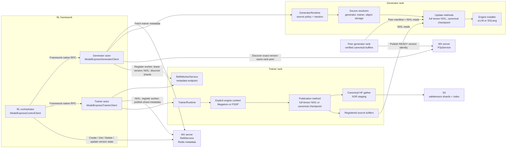
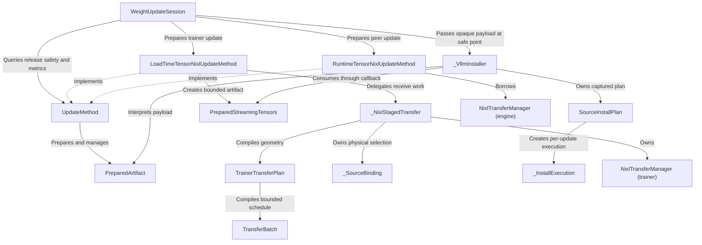
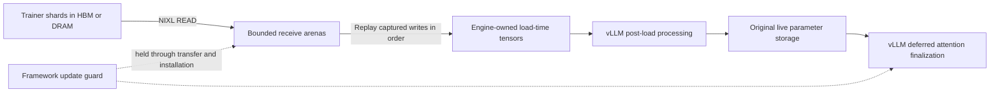

<!--
SPDX-FileCopyrightText: Copyright (c) 2025-2026 NVIDIA CORPORATION & AFFILIATES. All rights reserved.
SPDX-License-Identifier: Apache-2.0
-->

# RL refit architecture

This document describes the optional RL refit package and its server protocol, staged transfer flow, cache behavior, and failure handling. The base inference loader and P2P architecture are documented in [ModelExpress architecture](../ARCHITECTURE.md).

## Refit service and version model

### refit.proto - RefitService (Redis only)

`RefitService` is a new RL-specific control plane. It does not reuse or modify the
legacy `WeightSyncService`. The initial slice stores worker registrations,
immutable weight versions, and compact physical shard publications in Redis.
The control plane stores long-lived `TrainerMesh` membership as
`workers: worker_id -> TrainerTensorsMetadata(logical_shard_id, metadata_endpoint)`.
`bind_tensors()` computes address-independent coverage locally and returns
this compact reference. Adapters derive wire coverage without copying weights,
registering source buffers, or publishing a version. The adapter binding and
trainer `logical_shard_id` identify the same logical shard. Logical IDs hash canonical
coverage, so equivalent replicas share an ID. The orchestrator supplies the complete
trainer worker set and is responsible for logical-shard completeness. Mesh creation
resolves idempotent retries before contacting trainers and validates every binding
only for a new mesh. Mesh updates validate new workers and changed endpoints or
logical shards; unchanged members are not refetched. Large manifests never live
in Redis.
Admission first preflights worker registrations, then validates bindings with at
most 32 concurrent callbacks per request. Redis rechecks registrations atomically
when committing membership. Callback logs include the worker, endpoint, elapsed
time, and failures.
`CreateTrainerMesh` is idempotent; `UpdateTrainerMesh` replaces the complete
worker map with generation compare-and-swap while preserving logical coverage.
Every member requires an active model-matching trainer registration whose
`refit_endpoint` matches the binding endpoint. A worker-sharded `WeightVersion`
requires a trainer mesh; MX checks its existence and model atomically with version
creation. Object-storage versions omit the mesh. For worker-sharded versions,
`logical_shard_id` identifies a logical shard. MX accepts publications only from
workers in that shard's current membership and marks the version READY
when every logical shard has a current, live publication. Mesh-backed readiness
is computed from physical publications and their binding endpoints, not historical
coverage. Generator discovery reads the mesh
for complete expected shard coverage and filters out publications from replaced
workers and expired registrations. Generation changes invalidate cached transfer
plans; discovery rechecks the mesh generation after fetching worker manifests
to reject a snapshot that changed during resolution. Version leases protect
sources during installation. Publication release retries only the active-reader
lease rejection until its RPC deadline, retaining source buffers until deletion
succeeds. Mesh-backed trainers
can release published buffers before version retirement after all reader leases
drain. Removing a worker or rebinding its endpoint atomically retires its
publications and rejects the update while those versions have reader leases.
`ListWeightVersions` filters by model and optionally mesh, newest first. Mesh-filtered
listing uses the mesh's version index; metadata reads are pipelined.
`version_number` is optional caller correlation metadata, not version identity.
Object-storage callers manage version state; mesh callers do not manage readiness.

Mesh-backed `WeightVersion` records require a positive `trainer_mesh_generation`.
The unchanged creation API supplies a mesh ID; the server reads and stamps its
generation atomically while creating the version. Idempotent retries return the
original stamp. Shard publication, including the final READY transition and
repeated publications, rejects a changed mesh generation before writing. Trainer
resolution compares the recorded generation with the current mesh. Stored versions
require the generation field; decoding parses it as a uint64 without repeating
creation-time consistency checks. Versions without a trainer mesh, including object-storage
versions, carry generation zero. A requested version whose recorded mesh
generation differs from the current trainer mesh fails trainer source resolution.
The session can fall back to a generator peer serving the requested version.
Peer reads use complete runtime tensors, allowing recovery from an uncertain
installation even for a version published as a delta. Trainer and peer paths
check compatibility during plan selection; object-storage replay validates every
revision before acquiring the chain's leases.

Any trainer mesh update that changes its generation is rejected while a linked
weight version has an active consumer lease, including additive replicas that
leave existing publications intact. An update with unchanged membership remains a no-op.
After readers release their leases, membership may advance and new weight
versions capture the new generation; old version stamps are never changed.

DIRECT installation and pipelined worker streaming are
not implemented by this control-plane slice.
NIXL manifest endpoints belong to their physical worker shards; a typed object
storage source belongs directly to its durable `WeightVersion`. The protocol
can identify S3, Azure Blob Storage, or GCS. The Refit service and trainer
publication currently accept only S3. Generator checkpoint preparation accepts
S3 and Azure Blob Storage; exact desired-version startup remains S3-only.
On the NIXL path, weight bytes and full tensor manifests remain
on trainer workers. On the S3 path, rank zero uploads the version's global index
after every trainer rank has uploaded its owned shard. `XOR_DELTA` versions use
compressed XOR shards; `FULL_HF_CHECKPOINT` versions use native Hugging Face
safetensor shards and omit `base_version_id`. Frameworks own
tensor gathering, Hugging Face conversion, and bucketization, then pass a lazy
canonical bucket stream to the trainer client, which owns delta processing,
full-checkpoint serialization, and S3 shard construction.
Full-checkpoint staging uses the same bounded worker-pool pattern as delta
staging to update the rank-local snapshot directly with immutable CPU tensors.
`publish()` groups that snapshot into safetensors objects capped by
`MX_REFIT_FULL_CHECKPOINT_BATCH_BYTES` (4 GiB by default) and uploads the
rank-local objects concurrently. A tensor larger than the cap occupies its own
object. The trainer does not materialize a temporary HF checkpoint on disk.
During framework initialization, the same bucket stream seeds only that rank's
owned seed-checkpoint tensors through direct, concurrent
`prepare_delta_base()` bucket reads. The first real delta stage uses the
prepared snapshot without checkpoint I/O.
Each canonical S3 version owns an exact caller-supplied `object_storage.uri`
under the configured `uri_prefix`. That URI names the global index; delta shards
or full-checkpoint safetensors objects are stored as siblings. A delta index's
`compression_format` selects the receiver's decompressor. The current
implementation supports Zstandard. Unknown compression formats are rejected
before shard download. Full versions use a standard safetensors index, carry
optional per-tensor Adler-32 checksums under tensor-name keys in shard metadata
when the index declares `checksum_format="adler32"`, and reset the exact base
for later deltas.
Canonical S3 versions are retained for rollout fault recovery. Trainer
processes keep only the current base snapshot; older
immutable S3 objects are governed by external bucket lifecycle policy.

#### RL refit client architecture

The RL framework orchestrator calls only the public
`ModelExpressControlClient`. Framework-native RPCs invoke rank-local trainer and
generator clients inside their existing actors. Those clients use internal MX
control-plane and worker APIs; tensor bytes never pass through `RefitService`.



`RefitService` is the central metadata service defined by `refit.proto`. It
coordinates immutable versions, worker registrations, shard advertisements,
and leases, but it does not discover engine tensor layouts or transfer weights.
For NIXL, `GetTrainerShardMetadata` serves stable tensor geometry, buffer
addresses and registrations by digest. `GetWeightVersionShardMetadata` supplies
version-specific checksums separately. Generators cache stable metadata by mesh
generation, shard and worker, but check each version's publication and checksums.
With checksum verification disabled, the version metadata RPC is skipped.
Redis pins each worker/shard digest per generation; physical registration changes require advancing it.

Trainers publish stable metadata before version checksums and advertisements,
retaining staged buffer owners before registration and retaining checksums on registration errors.
Replacing physical metadata requires all owned versions to retire; version
checksum records are deleted only after the lease fence. Stable metadata remains
available for reuse. Mesh creation validates bindings; updates validate changed members.
For S3, `WeightVersion.object_storage` identifies the storage type and global
`model.safetensors.index.json` URI directly; the server validates only this
typed location and does not contact S3.
Trainer integrations provide the matching `ObjectStorageConfig` through
`ModelExpressTrainerConfig.object_storage`; the initial implementation rejects
providers other than S3 before creating the storage client.

The synchronous generator client returns a staged handle after source-specific
preparation, without changing live weights. Trainer-source preparation receives
a full copy; generator-peer preparation reserves a read that runs during apply.
The handle owns the version lease through installation at the caller's safe
point. Applying the weights or releasing an unapplied handle ends the lease.
Successful installation commits the serving version even if subsequent lease
cleanup fails. The cleanup error is reported; retrying apply retries lease cleanup
without reinstalling weights or publishing the version again.
With bounded staging configured, the same handle holds deferred batch reads;
`apply_weight()` performs pipelined transfer and installation.

Trainer metadata uses plaintext gRPC without worker authentication. Metadata
digests detect corruption but do not establish source identity. Deploy RL refit only on a trusted, network-isolated cluster and
prevent untrusted clients from reaching MX server and worker gRPC endpoints.
Transport authentication and TLS require a separate protocol and deployment
design; they are not provided by this implementation.

`GeneratorRuntime` composes source resolvers, update methods, and an engine
installer. Resolvers discover candidates without moving bytes; methods prepare
updates; installers apply them at the engine safe point. `WeightUpdateSession`
owns source order, compatibility matching, attempt budgets, fallback, replay
preparation, and version leases. It treats prepared payloads as opaque and asks
the method for metrics and release safety. Runtime initialization checks that the
installer supports the configured full-copy or bounded artifact before allocating
receive resources.

### Refit class responsibilities

Arrows show calls and resource ownership. Class docstrings describe each class's
responsibility; the streaming and failure contracts are detailed [below](#staged-transfer-caching-and-failure-handling).



- `inference/checkpoint_store.py` owns the host-local immutable lineage layout,
  locking, temporary-directory promotion, atomic JSON persistence, artifact
  fingerprints, and activation state.
- `inference/receiver.py` owns canonical S3 and Azure downloads, safetensors validation,
  and XOR reconstruction into derived checkpoints.
- `object_storage_reader.py` defines the shared checkpoint-reader interface
  implemented by `S3Client` and `AzureBlobReader`.
- `inference/engines/sglang/installer.py` reloads a prepared canonical checkpoint
  through SGLang's native safetensors loader, using `DefaultModelLoader.Source`
  to retain the engine's source defaults, including weight-file pattern selection.

Canonical checkpoint preparation selects `S3Client` or `AzureBlobReader` from
`ObjectStorageGeneratorConfig.storage_type`. Both implement `ObjectStorageReader`
and share full-checkpoint validation, XOR delta replay, cache promotion, and
activation. Every source in a replay chain must match the configured provider;
a mismatch fails before downloads begin. Azure full checkpoints download to disk
before installation. The optional full-checkpoint streaming path remains S3-only.
Azure publication and exact desired-version startup require separate support.

Canonical preparation requests queue on a separate `.prepare.lock`. Once the
leader has reconstructed a target, followers verify and attach to that READY
checkpoint with shared installation and cache locks. They can therefore prepare
while another rank loads the same checkpoint. A cache miss releases the shared
locks, acquires the exclusive installation/cache fences, and rechecks the state
before reconstructing. Cache-hit attachment performs no eviction; capacity is
enforced by initialization, reconstruction, and activation.

| Canonical checkpoint operation | `.prepare.lock` | `.install.lock` | `.lock` |
|---|---|---|---|
| Attach to an already prepared target | Exclusive | Shared | Shared |
| Reconstruct a target | Exclusive | Exclusive | Exclusive |
| Load engine weights | None | Shared | Shared |
| Commit activation when the installation context exits | None | Shared | Exclusive |

The corresponding trainer composition is owned by `TrainerRuntime`. Public
`FSDPTrainerContext` and `MegatronTrainerContext` select only engine capture;
full-tensor NIXL and canonical-checkpoint object-storage publication remain separate
method implementations. This keeps transport, payload preparation, engine
geometry, and framework orchestration independently replaceable.

Miles owns `UpdateWeightFromModelExpressDelta` in
`miles.backends.training_utils.weight_update.protocols.modelexpress`. Its
`modelexpress` transfer mode uses the shared SDK's staging and publication APIs
below. The SDK does not depend on Miles.

Canonical S3 publication accepts either `stage_shard(tensor_iter=...)` for a
complete weight stream or repeated `stage_shard(tensors=bucket)` calls for one
version. The runtime dispatches these to the canonical method's `stage()` and
`stage_bucket()` respectively. Both use the same bounded encoding pool for XOR
deltas and full HF checkpoints. The iterator form finishes staging before returning; bucket calls
enqueue work, and `publish()` drains it before publishing the complete version.
Submitting a bucket for a different version before publication is rejected
without modifying the staged payload.

```python
# Each publisher has at least one bucket; the first initializes staging.
for bucket in local_buckets:
    staged = trainer.stage_shard(version=version, tensors=bucket)
staged.publish()  # Collective across the configured publication process group.
```

The Miles adapter creates this process group from sender ranks only. Non-senders
still join the framework's weight gathers and barriers, but do not create an MX
trainer or call publication. Full-tensor NIXL publication uses `bind_tensors()`
and `publish_version(version=...)`.

Bucket staging retains the bucket and its tensors, so their contents must remain
stable until publication finishes. Callers submit all buckets for one version
before publishing, and retry failed uploads through the same publication handle.
The base version advances only after successful publication.

Staging initializes a fresh artifact and encoding pool for each new version;
successful publication clears that state. Empty buckets initialize ranks with no
local tensors so they can still participate in collective publication. A failed
iterator is discarded automatically and can be retried from the beginning. For
incremental bucket submissions, a worker failure prevents publication. Use
`trainer.close()` to discard the staged work and close the client.

`ModelExpressGeneratorConfig.staging_buffer_bytes` sets bounded-streaming
capacity per arena, and `staging_buffers_count` defaults to one. The streaming
client uses their product as its total staging limit. `staging_device` selects
CUDA or pinned host receive memory.

For trainer sources, `stage_weight()` prepares a complete private copy unless
bounded staging is configured. In bounded mode it defers reads to `apply_weight()`;
the [streaming installation contract](#bounded-vllm-streaming-installation)
describes arena reuse, replay, and cleanup. Both modes retain the version lease
through installation.

`MX_REFIT_PREFETCH_REPLICA_METADATA` fetches all needed replicas up front.
`MX_REFIT_DEBUG_VALIDATE_REPLICAS` checks equivalent canonical coverage.

Trainer transfers batch consecutive captured source writes up to the staging
limit, preserving their recorded order. The legacy `MX_REFIT_PACK_MODULES`
setting has no effect on ordered source replay.

Before vLLM rebuilds per-module load-time parameter skeletons, the adapter records
shared parameter objects and reconnects those aliases afterward. Alias owners
must remain at the same module paths during restoration and final processing;
replacement or removal fails the refit, including owners with no separately
published parameter and multiple paths to the same module. Capture then
counts tied weights once, and installation preserves their shared kernel storage.
Alias groups with inconsistent load-time shapes or dtypes are rejected.
Streaming owner checks resolve aliases against the live parameter objects on
each batch. An owner may reuse a shared parameter installed by an earlier batch
only while it still points to that exact committed object; a missing or rebound
parameter is rejected. Installation reconnects shared bindings after each
managed owner's kernel-storage restoration, before dependent hooks execute.

Full-copy or bounded mode is fixed for the client's lifetime. Streaming is
opt-in and trainer-only for supported vLLM models, including quantized models.
It does not publish generator peers. After proven cleanup of a failed install,
`stage_weight()` can start a fresh, leased full-tensor transaction; the engine
remains uncertain until that transaction succeeds. The hosting framework must
keep every replica paused until complete recovery. Unproven cleanup requires a
process restart; see the [failure and resource-lifetime rules](#bounded-vllm-streaming-installation).

| RPC | Request | Response | Purpose |
|-----|---------|----------|---------|
| `RegisterWorker` | `RegisterWorkerRequest` | `RegisterWorkerResponse` | Register or refresh one TTL-bound worker process |
| `CreateWeightVersion` | `CreateWeightVersionRequest` | `CreateWeightVersionResponse` | Idempotently create one immutable `STAGING` or already-published `READY` version |
| `GetWeightVersion` | `GetWeightVersionRequest` | `GetWeightVersionResponse` | Read the version and its lifecycle state |
| `DeleteWeightVersion` | `DeleteWeightVersionRequest` | `DeleteWeightVersionResponse` | Cancel a `STAGING` version or move a `READY` version to `RELEASING` for retirement |
| `UpdateWeightVersionState` | `UpdateWeightVersionStateRequest` | `UpdateWeightVersionStateResponse` | Explicitly update lifecycle state, including S3 `STAGING` to `READY` |
| `CreateWeightVersionShard` | `CreateWeightVersionShardRequest` | `CreateWeightVersionShardResponse` | Publish one worker manifest for a required logical shard |
| `ListWeightVersionShards` | `ListWeightVersionShardsRequest` | `ListWeightVersionShardsResponse` | List the version's physical source publications |
| `DeleteWeightVersionShard` | `DeleteWeightVersionShardRequest` | `DeleteWeightVersionShardResponse` | Evict one source shard after release when no lease protects the version |
| `RegisterVersionLease` | `RegisterVersionLeaseRequest` | `RegisterVersionLeaseResponse` | Acquire or renew protection while installing a version |
| `DeleteVersionLease` | `DeleteVersionLeaseRequest` | `DeleteVersionLeaseResponse` | Release a generator's protection of the version shards |

`RefitWorkerService.GetTrainerShardMetadata` and
`RefitWorkerService.GetWeightVersionShardMetadata` are unary metadata RPCs; tensor
bytes remain on the advertised data-plane transport.

The final missing NIXL source slot atomically changes the version to `READY`.
For S3, the orchestrator marks the version `READY` after publication completes.

Peer generators reuse the existing inference P2P metadata service rather than
creating a second Refit peer registry. A generator serving an exact version
publishes its normal `SourceIdentity` with `revision=WeightVersion.uid`; another
generator queries `P2pService.ListSources` with the same engine-compatible
identity and selects a READY source for its worker rank before falling back to
trainer shard publications. Applied generators publish their complete post-load
runtime tensors, including registered runtime buffers. An identical-rank peer
validates that exact runtime representation before mutation, then pulls it
directly into the existing live tensor storage at the engine safe point. This
avoids a second model-sized GPU allocation and copy.
The peer holds a donor read lease through NIXL completion. Before the donor's
next active refit, it rejects new reads and waits for all leases to drain; a
drain timeout aborts before any live tensor is overwritten.
Trainer NIXL inputs remain a separate load-time representation that runs through
vLLM's normal post-weight-load processing.

The vLLM inference loader discovers this post-load tensor set once and retains
the device-local mapping. The RL runtime reuses that mapping for peer layout
validation, publication, and in-place installation instead of walking the model
again after warmup or compilation. It also borrows the loader-owned NIXL agent:
the already-registered live tensors are the peer receive destination, and the
loader retains responsibility for shutting down the rank-local transport. A
failure after the direct transfer starts leaves the engine state uncertain, so
MX fences it rather than attempting in-process source fallback. This path
requires a nonempty loader-owned runtime tensor mapping and an initialized
NIXL manager. Model quantization, FP8 KV-cache dtype, and execution mode do not
gate peer selection. With `model_config.enforce_eager=True`, after validating
the live destinations, the RL installer uses the same host-scale refresh as
cold RDMA loading: q/k/v Python scalars and CPU mirrors are updated from the
received accelerator tensors (using the maximum for per-head scales), with
tensor storage preserved. It also invalidates the
FlashInfer BMM and output-scale caches together so the next eager forward
recomputes them. It does not rerun post-weight-load processing on tensors that
are already in runtime format. Invalid scale contracts fail installation and
leave the mutated engine fenced.

Without `enforce_eager`, peer refits retain the existing direct-copy behavior
and do not run this host-scale refresh. Updating host mirrors alone cannot
update scalar values already captured in CUDA graphs; graph-scale refresh and
recapture remain outside this eager-mode fix.
Cold RDMA loading requires lazily populated attention caches to be uninitialized.
Q/K/V-only attention paths, including MiniMax-M3 sparse attention, do not need an
`_o_scale_float` field; that field is specific to output quantization. DeepSeek
V4/V4.1 FlashInfer instead recomputes its constructor-initialized BMM scalars from
the received custom Q/KV scale buffers. Its GPU scale buffers stay unchanged.
Recognized DeepSeek packed KV attention (`fp8_ds_mla` / `nvfp4_ds_mla`) carries
per-block scales in the cache format and needs no standard host mirrors. Each
`AttentionLayerBase` owner declaring FP8 KV cache must have a recognized scale
contract, even when another layer was refreshed or uses a supported packed format.
Container modules and `MambaBase` state-space layers are not attention scale owners.

An object-storage generator with full-tensor engine support defaults to a
same-rank generator peer first and the version-level object-storage source
second. Engines without that support use object storage directly. An explicit
`source_order` may select object storage only or combine `GENERATOR` and
`OBJECT_STORAGE` in either order. A memory-backed generator defaults to a peer
first and trainer manifests second. If the rank-local NIXL transport cannot be
initialized, an object-storage generator drops the peer attempt and remains
available with object storage as its only source.

For an active refit, the peer lookup is for the exact target UID. If no peer can
prepare that version, the generator resolves the full canonical lineage from
its `FULL_HF_CHECKPOINT` root through the target deltas. Under the local cache
lock, the receiver reuses its verified checkpoint when that version is on the
target lineage, downloading and applying only the missing revisions before
installing the target. Full-root reconstruction is retained when no matching,
source-verified local checkpoint exists, including an unverified launch seed.
A successful peer refit does not rebuild the canonical checkpoint in the
background, so the local checkpoint may lag the engine's serving version.
Fallback therefore resumes from the local checkpoint version. Object storage
is consulted only when a later refit cannot use P2P.

With `MX_REFIT_DELTA_SURGICAL=true` (default `false`), vLLM checkpoint refits
track delta tensor names and the last completely installed checkpoint version.
Known lineage selects whole destination modules for graph-safe layerwise reload;
unknown lineage or a partially loaded module falls back to a full reload. Peer,
bounded tensor streaming, and failed installs clear the tracked checkpoint version.
When disabled, the receiver skips delta-name lineage reads and the installer uses
the full checkpoint path. See [the delta refit guide](S3_DELTA_WEIGHT_REFIT.md).

The canonical receiver retains each full checkpoint and delta payload under its
version, then writes a resolved chain manifest. A full target is directly
installable. The first delta after a full checkpoint copies that immutable full
checkpoint into a version-scoped derived checkpoint. On Linux the checkpoint
store attempts `FICLONE` per regular file, sharing blocks copy-on-write where
the filesystem supports reflinks. Unsupported filesystems, cross-mount copies,
and other platforms use an ordinary copy. This includes `EBADF` from `FICLONE`
on already-opened files when the source filesystem cannot reflink.
File metadata and symlink dereferencing
retain `copytree`/`copy2` behavior; mutable files never use hard links. Clone I/O,
permission, and capacity failures abort preparation and clean its temporary
directory before promotion. Later sequential deltas
rename the active materialization and apply only the incoming XOR delta in
place, avoiding another full-model copy. Canonical artifacts are never modified
during reconstruction, and derived checkpoints can be rebuilt from the lineage.
If an in-place delta fails, the cache remains `UPDATING` until the active refit
session or the next initialization restores the immutable full root. The running
engine retains its previously installed weights.

The local checkpoint store caps its configured quota at the existing model cache
size plus free disk space. It logs any cap applied at initialization and rechecks
free space before known writes and copies. Capacity checks evict stale
checkpoints or reject the update while preserving protected lineage.
Reflinks retain logical-size accounting and the full first-materialization
free-space check: delta writes can allocate private blocks. This is an admission
check, not a filesystem reservation against concurrent users. Reflink support
must be tested on the actual checkpoint cache mount; a Kubernetes `emptyDir`
does not establish support. First-refit latency savings require a fresh benchmark
on that mount; existing sequential-reuse timings do not measure this optimization.

Under the local checkpoint lock, preparation state advances from `READY` to
`UPDATING` before artifact construction and back to `READY(target)` only after
verification. `active.json` is a separate commit point: it advances only after
the engine installer returns successfully. Download, reconstruction, and install
failures therefore retain the previously active engine version and immutable
lineage. A separate installation fence is shared by co-located installers and
exclusive to preparation, so preparation cannot enter between engine reload and
activation.

RL cold-start bootstrap populates only the immutable full-checkpoint cache; it
does not rewrite preparation or activation state. Generator ranks sharing that
cache use local rank 0 as the preparer. Global rank 0 first broadcasts one
immutable desired UID, and every rank verifies its local configuration against
that pinned value before agreeing on the replay chain. Node-local followers attach to the
verified `READY` checkpoint. A CPU-process-group barrier keeps every rank out of
the engine's distributed checkpoint loader until all nodes are prepared. The
cache activation commit runs only after every engine rank reports a successful
load; configuration drift, phase disagreement, or a partial load fails the
cold start without advancing `active.json`.

Startup P2P does not populate the canonical disk checkpoint. If hotload starts
with a missing or unrecorded cached seed and no preparation state, the S3 method
defers initialization until object-storage fallback is needed. It resolves the
full replay lineage and downloads a source-verified full root before applying
deltas. This does not activate the disk checkpoint or change the serving UID;
activation still follows successful engine installation. Recorded artifacts
continue to undergo integrity verification. The bootstrap requirement is checked
on every replay request. Once initialized, an object-storage-only runtime can
resolve from its serving version instead of revisiting the full lineage. Mixed
P2P/object-storage runtimes still resolve from the full root because their disk
checkpoint may lag the serving version.

The engine's serving version remains separate from checkpoint-cache state.
vLLM constructs its Control server only after EngineCore and its workers finish
loading. Because an explicit desired UID makes the MX loader fail closed, the
Control endpoint is reachable only after every rank loads that UID. The MX
startup probe then calls vLLM's native `UpdateWeightVersion`, reads it back with
`GetWeightVersion`, and succeeds only on an exact match. Dynamo's main sidecar
therefore cannot start or admit the worker before vLLM reports the loaded UID.
When the weight-transfer backend is initialized later, the controller passes
that observed UID as `initial_serving_version_id`; the canonical
`initial_base_version_id` continues to describe only replay lineage.

`WeightVersion.uid` is MX's opaque version identity. A create request may supply
the UID; MX generates one when it is omitted. Creating another version with an
already-used caller-supplied UID returns `ALREADY_EXISTS`. For an `XOR_DELTA`,
`base_version_id` identifies the base version's UID. The canonical index records
these UID strings as `metadata.version` and `metadata.base_version`. MX assigns
no numeric ordering and requires no version-directory naming convention; the
exact `object_storage.uri` identifies the version's global index.
Generators use the registered MX IDs and base relationships for replay. A delta
index's `metadata.version` and `metadata.base_version` are optional descriptive
fields and may differ from the MX IDs. Cache paths and chain records use MX IDs;
MX lineage checks and payload validation remain enabled. The registering caller
is responsible for selecting the correct S3 artifacts and base mapping.
`WeightVersionShard` identifies a per-worker version publication.
Its identity is `(version_id, worker_id, logical_shard_id)`: `logical_shard_id`
identifies the logical shard covered by the publication, and
`worker_id` identifies the publishing process. The trainer engine adapter
derives the logical shard ID from its native topology; the Megatron adapter uses
the logical tensor names and shard geometry, excluding physical process and DP
replica identity. The orchestrator deduplicates those adapter-defined logical shards when
declaring the version's expected contributions. Multiple DP workers may therefore
advertise the same logical shard; generators rotate through those publications on
transfer retry. Each shard carries `metadata_endpoint`, `stable_metadata_digest`, and an optional
`version_metadata_digest`. Tensor counts and byte totals live in stable metadata,
where they are computed once when the physical metadata is initialized.
Deployments configured with
Kubernetes or the test-only memory backend do not expose `RefitService` yet.

`RegisterWorker` is also the heartbeat API. `worker_id` is a fresh process
incarnation identity, so a restarted worker registers a new ID instead of
fencing an old registration. The registration expires with its TTL; source
planning and source discovery will use that liveness when selecting a
publication.

Cross-key compare-and-set operations live in documented Redis scripts
under `modelexpress_server/src/refit/backend/redis/scripts/`. Redis executes
each script atomically. The `refit_service_redis` test drives the public gRPC
API through two server replicas and covers concurrent version creation,
concurrent final source-slot publication, idempotent and conflicting replay,
replacement-source publication, lease-protected release, and safe shard
eviction. CI runs this test against Redis 7.

A future Kubernetes backend can preserve this gRPC contract, but it cannot
translate each Redis key into an independent CRD and retain the same atomic
guarantees. Lease creation and shard deletion race across resources. The
Kubernetes implementation therefore needs one version-scoped coordination
object as the serialization boundary, updated with `resourceVersion`
compare-and-swap; shard and lease objects can remain child records.
`RefitService` depends on the domain-level `RefitBackend` contract, with Redis
implemented under `refit/backend/redis.rs`. Kubernetes remains a separate
end-to-end backend slice implementing the same transaction boundaries.

### refit_collective.proto - RefitCollectiveService (Redis only)

Rendezvous and admission for the NCCL M2N collective refit path, which is a
sibling of the NIXL pull path rather than a mode of it. The two share no types:
this service reuses only `RegisterWorker` and the `WeightVersion` lifecycle from
`refit.proto`. Design: [`NCCL_M2N_REFIT.md`](../NCCL_M2N_REFIT.md).

Where the pull path hands a generator a shard table to read one-sidedly, here
both sides enter one collective together, so MX brokers the NCCL bootstrap
instead. Weight bytes never reach the service, and neither does the reshard
plan: MX stores only its digest and the endpoint that serves it.

| RPC | Purpose |
|-----|---------|
| `CreateCollectiveTransfer` | Idempotently open one refit operation against a group |
| `GetCollectiveTransfer` | Read an operation and its lifecycle state |
| `DeleteCollectiveTransfer` | Drop a terminal operation and release its idempotency key |
| `JoinCollectiveGroup` | Admit one worker, returning its MX-assigned rank in every lane it joins |
| `GetCollectiveGroup` | Poll group state, lane bootstrap, and participants |
| `PublishGroupBootstrap` | Record one lane's `ncclUniqueId`, stamped with the epoch it was generated for |
| `ReportCollectiveTransfer` | Record one participant's terminal result, fenced on operation, epoch and worker generation |

A group is keyed by its declared membership, so every participant of one
operation resolves the same group without a separate create call, and is reused
across refits until its `epoch` moves. The epoch bumps on a membership change, a
new worker generation for an existing slot, or a changed plan digest; each of
those invalidates a cached communicator, a cached plan, or both, and clients
drop them together. Bumping clears every lane's bootstrap identifier in the same
transaction, because an identifier from a previous epoch names a communicator
whose world size no longer matches the membership.

The client-side control plane lives in `modelexpress_rl/collective/` and is
deliberately torch-free, NCCL-free and CUDA-free, so the plan contract and the
rendezvous are testable without a GPU. Two guarantees there are gates rather
than conventions, because both failures are silent at refit time: `plan.py`
proves that the bulk and misc lists together name every parameter exactly once,
and folds that result into a plan digest every participant must agree on before
the group becomes READY. The digest also covers the receiver protocol and the
M2N ABI version, so peers that could not speak to each other fail to form a
group rather than discovering it inside a collective. When digests do disagree,
`GetCollectiveGroup` reports which slots differ; without that the group simply
sits in `FORMING` and every lane bootstrap looks stale, which points at the
wrong subsystem.

Before `JoinCollectiveGroup`, each worker must call `RefitService.RegisterWorker`
with the same `worker_id`, model, and role, then renew that immutable registration
through communicator setup, transfer, and terminal reporting (the client must
renew no less frequently than once per third of the registration TTL). Join and
bootstrap transitions validate the registration atomically. `GetCollectiveGroup`
also removes expired generations, advances the epoch, and clears lane bootstrap
identifiers before returning state, so `READY` cannot survive a dead rank.

Lanes are declared by the caller, not derived. `CollectiveGroupSpec` carries one
`LaneSpec` per communicator the operation needs, each an ordered list of slots,
and MX brokers one bootstrap per lane, gives each slot the rank its position
gives it, and gates readiness on all of them. It does not know what a lane means:
tensor, expert, data and pipeline parallelism stay client-side, and a caller that
splits its trainers unevenly is simply declaring different lanes. What
`refit_collective/lanes.rs` still checks is structural - unique lane ids, slots
that exist, no slot twice on one lane, no expected slot left off every lane, at
most one broadcast lane - and none of those is a claim about topology.

Lane order is part of the group's identity. The declared membership is hashed
into the group id along with the expected slot lists, so two callers that put
different slots at rank 0 resolve different groups instead of meeting in one and
disagreeing about who is who.

The data plane lives in `collective/{backend,client,comm,spi}.py`. `nccl4py` is
imported lazily, so the plan contract and the rendezvous stay usable and
testable where it is not installed. Both halves walk the same plan in the same
order, because a collective requires every participant to issue an identical
sequence: a rank that skips a parameter its peers issue hangs the communicator
rather than failing alone. The misc broadcast is one phase per refit in
`finish_weight_update`, never per layer group, since its communicator spans
every rank and overlaps every reshard lane.

There is no group-delete RPC, symmetrically with workers never creating one.
Expired generations are fenced now; reclaiming the resulting empty group hashes
after their last operation is deleted still requires a backend reaper/index and
is not implemented in this slice.

Source layout:

```text
modelexpress_server/src/
├── refit_collective.rs              # Collective refit module exports
└── refit_collective/
    ├── lanes.rs                     # Declared lane membership and rank lookup
    ├── service.rs                   # Backend-neutral collective gRPC service
    ├── backend.rs                   # CollectiveBackend contract and factory
    └── backend/                     # Redis backend and atomic Lua scripts

modelexpress_client/python/modelexpress_rl/
├── collective/                      # NCCL M2N collective path (torch-free core)
│   ├── types.py                     # Placement, MeshSpec, ParamPlan, ReshardPlan
│   ├── plan.py                      # Coverage gate, plan digest, default derivation
│   ├── rendezvous.py                # MX-brokered join, readiness, bootstrap, report
│   ├── spi.py                       # Publisher/Loader engine boundary, LocalParamSpec
│   ├── comm.py                      # Communicator cache keyed by (group_id, epoch)
│   ├── backend.py                   # NcclM2nSender / NcclM2nReceiver
│   ├── client.py                    # RefitClientTrainer / RefitClientGenerator
│   └── envs.py                      # Deadlines and stream count
├── refit_collective_pb2.py          # Generated protobuf stubs
└── refit_collective_pb2_grpc.py     # Generated gRPC stubs
```

## Python engine integration

### SGLang refit integration

SGLang obtains its rank-local object-storage refit client through
`modelexpress_rl.inference.engines.sglang.get_modelexpress_generator(model_runner)`.
The factory reads `model_runner.server_args.modelexpress_config` as JSON or a
dictionary, resolves the local seed checkpoint when no seed path is supplied,
and reuses the client cached on `model_runner.modelexpress_generator`.
`object_storage_type` selects `S3` (the default) or `AZURE`. S3 connection settings
use `object_storage_endpoint_url` and `object_storage_region_name`, matching the
vLLM integration. Azure rejects these S3-only settings and uses the Azure SDK
authentication configuration. SGLang owns update coordination and closes the
cached client during scheduler shutdown.

### vLLM Refit Installation

The vLLM integration exposes engine installation and tensor geometry to
`GeneratorRuntime`; it does not select a transport or source. Runtime composition
uses separate NIXL methods for trainer load-time tensors and generator runtime
tensors, and adds the canonical-checkpoint method when object storage is
configured. XOR deltas mutate an exact base; full HF checkpoints stream tensors
into the existing mmap-backed checkpoint and become the base for later deltas.
All methods feed the shared private installer, which commits staged tensors or
reloads a prepared checkpoint through vLLM's graph-safe layerwise reload path.
Before a reload, the installer restores registered slots for live kernel buffers
that were created after vLLM recorded its load-time metadata. PWAL can then
replace those buffers without turning them into conflicting plain attributes,
and vLLM's normal finalizer copies them back into their original graph-bound
storage. Deferred post-load hooks can also replace registered device buffers,
including MLA's `_q_scale_inv` and `_k_scale_inv`. The installer snapshots both
bare device tensors and registered buffers in its reload plan, then copies updated
values into the original storage and restores tensor identity after finalization.
This preserves addresses used by captured graphs and ModelExpress registrations,
including persistent and nonpersistent buffers and their `state_dict` membership.
The original buffer persistence setting is restored even if a hook changes it
or re-registers a buffer without specifying `persistent`.

The ModelExpress vLLM plugin registers one `modelexpress` native weight-transfer
backend for both paths. An empty initialization payload preserves the existing
NIXL path. The payload can override the logical ModelExpress model name when it
differs from vLLM's model path. Supplying `object_storage_type` with the READY
seed-base version ID, seed checkpoint path, and refit checkpoint directory
selects the object-storage path, which accepts `S3` or `AZURE`. The payload
can also override the MX server through `server_url` and the storage connection
for S3 through `object_storage_endpoint_url` and `object_storage_region_name`. Each
update carries the opaque MX `version_id`.
`start_weight_update()` opens the update window, `receive_weights()` stages and
applies the version through `ModelExpressGeneratorClient`, and
`finish_weight_update()` releases its staged handle. Each session accepts one
version; calls before initialization, out-of-order calls, and a second update
raise instead of reporting success. vLLM's reset hook releases staged resources
and clears the session after an update error, including invalid payloads rejected
before receiving weights. A failed finish retains the session so cleanup can be
retried; already applied model weights are not rolled back. Draft-model updates remain
unsupported, and trainer-pushed bytes are ignored because trainers publish
WeightVersions through `ModelExpressTrainerClient`. After a successful apply,
the bridge merges staging
and installation metrics and logs each numeric `perf/` phase as a separate INFO
line in deterministic key order. `perf/mx_receive_stage_weight_time` covers the
complete `ModelExpressGeneratorClient.stage_weight()` wall-clock call.

The active vLLM refit installer lives in
`modelexpress_rl.inference.engines.vllm.installer`. It captures canonical
load-time destinations and aliases once for the generator client's lifetime,
then installs updates into the live model. Checkpoint reloads use vLLM's
layerwise loader and post-load processing so quantized and graph-bound weights
retain their engine-owned behavior. Replacing the engine or changing its loader
semantics requires a new client.

RL refit timing and transfer planning live under `modelexpress_rl.refit`.
The RL-specific `MX_REFIT_*` and `MX_RESHARD_*` settings are registered in
`modelexpress_rl.envs`; shared client configuration remains in
`modelexpress.envs`.

### No-gather Refit Resharding

`modelexpress_rl.refit.reshard` captures the slices and destination views selected
by an engine's own weight loader, intersects them with trainer-published
shards, and compiles one-sided read descriptors without materializing a full
trainer tensor. Geometry, slice planning, transfer planning, and the transport
protocol are engine-agnostic.

Geometry capture passes all lazy source weights through the engine loader in
one call, amortizing model-wide parameter and expert-map construction. Each
lazy tensor retains its original source identity, including native-to-HF view
conversions. If an unsupported operation interrupts the bulk attempt, the
recorder rolls every accumulator it advanced back to the attempt's starting
state before retrying each source individually for precise diagnostics, so bulk
capture still never produces an incorrect partial plan. The bulk cause is logged
even when the per-source retry then succeeds for every source, because bulk order
can trip a loader that per-source order does not. Unexpected engine errors
propagate, and parameter loader hooks are restored on every exit. This optimizes
the first capture without caching layouts across model or source changes.

Trainer adapters encode registered shard geometry in stable worker manifests.
The refit control plane owns worker registration, immutable version publication,
and version leases; receivers resolve those manifests before planning transfers.
Megatron and FSDP use this shared lifecycle.

`modelexpress_rl/inference/trainer_plan.py` owns trainer-plan compilation and
validation. `inference/nixl_staged_transfer.py` owns trainer source staging buffers,
physical transport and verification. Direct generator-peer reads
and donor lease cleanup belong to `inference/methods/runtime_tensor.py`. The
vLLM-specific
`installer.py` captures trainer load-time geometry through layerwise reload and
installs it through `process_weights_after_loading`. For tensor and checkpoint
reloads, vLLM owns quantization-aware refresh of MLA's `W_UV` and `W_UK_T`;
ModelExpress preserves their graph-bound storage when post-load processing
replaces these bare tensor attributes. The RL installer does not recompute MLA
weights from `kv_b_proj.weight` or reject quantized MLA models. After reload,
the installer checks that vLLM replaced each existing `W_UV` and `W_UK_T`
before copying it back into its original graph-bound storage. An unchanged tensor
identity raises `IncompleteRefit` rather than accepting a potentially stale update.
Compatibility is checked through this post-load behavior, not a version-string
gate, so nightly and source builds can be used. The check runs after weight
loading; a failed refit requires engine recovery before serving resumes.
Generator peers instead
transfer the complete post-load runtime tensor set directly into existing live
storage without re-running PWAL. The adapter rebuilds a trainer plan when
validated source manifests change; an incompatible destination staging layout
requires an engine restart.

### Experimental streamed full refit

Streamed refit requires `runai-model-streamer>=0.17.0` for ranged window reads.
For S3-compatible storage, configure matching `AWS_ENDPOINT_URL` and
`AWS_DEFAULT_REGION` on every generator worker. The generator's
`object_storage_endpoint_url` and `object_storage_region_name` configure the
`S3Client` index read; shard reads use RunAI's separate configuration.

With `MX_REFIT_FULL_STREAMING=true`, vLLM can stream a new, non-checksummed full
HF checkpoint directly from indexed S3 shards through its existing graph-safe
layerwise reload. Workers without a cached seed first use the canonical S3
bootstrap path to establish tensor metadata. `inference/streaming_checkpoint.py`
verifies names, shapes, dtypes, byte sizes, uniqueness and complete iterator
consumption. Declared checksums keep the existing canonical verified download
path. Partial engine mutation retains the normal refit failure fencing; it never
silently falls back.

Distributed ModelStreamer shares the S3 payload read across TP ranks. Local rank
zero snapshots the yielded tensors to owned CPU buffers before model loading can
mutate them, then a background writer reconstructs ordinary safetensors shards.
Other ranks do not write the cache. Tensor bytes remain exact, while generated
headers and offsets can differ from the source. Pending snapshots are bounded to
2 GiB, allowing one larger tensor. Copies and backpressure can affect install time;
this is asynchronous disk writing, not a guarantee of zero disk influence.

Layerwise reload frees a layer's incoming tensors only after the whole layer has
arrived. ModelStreamer's distributed partition spreads each layer across ranks, so
a single whole-checkpoint stream can leave most layers partially loaded at once.
The installer therefore streams `MX_REFIT_STREAM_WINDOW_LAYERS` decoder layers
(`layers.<N>`) per ranged request, default 2, after one metadata read. Non-layer
tensors form a leading window. Every byte is still read once and the cache tee is
unchanged; `0` restores the single stream.

The writer uses the existing cache locks, quota, source records and atomic directory
promotion. It publishes only after complete streaming and successful installation,
and adopts the checkpoint in `state.json` and `active.json` when activated.
Deferred activation waits for cache publication before adopting it. The next
canonical replay waits for local writer completion and can reuse its full ancestor
without another payload download. A writer failure is logged without failing
deferred activation and is reported once as a preparation error before the owning
rank prepares a subsequent canonical update. All tracked writers are drained
before that error is surfaced, so a retry can proceed. Completed successful
streams are pruned during subsequent preparation. Shutdown drains or discards
outstanding writes.
The operation lease already covers all remote reads; the disk tail consumes only
owned local snapshots. Cache readiness is logged separately from serving readiness.
CPU snapshot and backpressure times appear in the install metrics as
`perf/mx_stream_cache_snapshot_time` and `perf/mx_stream_cache_backpressure_time`.

See the [RL refit package](../../modelexpress_client/python/modelexpress_rl/refit/__init__.py)
for its public timing and resharding exports. The deployment behavior and
validation details are described in this architecture section and the
[deployment reference](../DEPLOYMENT.md).

## Staged transfer, caching, and failure handling

### Bounded vLLM streaming installation

The generator streams captured source writes through reusable receive arenas in
loader order, including writes that revisit an earlier owner. Each source write
must fit one arena; preparation rejects oversized writes before connecting sources.
One installer uses vLLM's reload lifecycle for supported unquantized and quantized
models.
Quantized MoE graphs captured between refits can retain stale scale references;
use eager execution or startup-captured graphs.



The installer lazily captures the trainer-to-Hugging-Face conversion together
with vLLM's native loading operations, destination geometry, owning module groups,
alias restoration metadata and graph destinations. The capture cache and replay schedule
are published only after complete coverage and restoration of the live model.
An incomplete capture returns its diagnostics without caching a replay plan;
failed or incomplete construction can be retried. Each update opens one reload
window, materializes load-time destinations, then replays captured writes in their
original order. vLLM performs post-load processing and restores kernel tensor
bindings; finalization handles attention dependencies after all inputs arrive.
Native materialization selects its recorded device, while host bookkeeping can
be recreated on CPU. Bare tensors retained by graph consumers keep their storage.
MX does not implement model-family admission tables or attention-specific weight
transformations.

Receive-arena tensors are never attached to the model or passed to post-load
callbacks. The copy boundary requires ordinary Tensor storage views and rejects
custom dispatch modes. A callback may retain an engine-owned tensor without
preventing arena reuse; CUDA completion is required before another READ overwrites
an arena. Captured installation preserves aliases needed for tied parameters and
runtime bindings. Alias validation distinguishes repeated paths to one slot from
ties between distinct slots, and checks relevant edges after callbacks without
caching validation verdicts across callbacks or updates.

Before reload initialization, alias restoration uses vLLM's recorded parameter
metadata to separate load-time ties from runtime-only aliases such as WNA16's
`w13_weight` and `w2_weight`. Capture and checkpoint loading reconnect only the
load-time slots; native post-processing recreates runtime aliases. Missing
load-time slots still fail restoration, and final runtime identity and storage
validation remains required.

During geometry capture, writes to live registered parameter or buffer storage,
including views and detached aliases, are rejected before execution and reported
as unsupported sources. Lazy-source copies remain record-only, and independent
scratch tensors may still be mutated. The guard ends when capture exits; it does
not change installation or native post-load processing.

Load-layout capture caches a deep copy of the result and returns another deep
copy on a cache hit, preserving shared references within each result while
isolating callers' mutations. The existing model, loader, routing and manifest
keys decide whether capture can be reused. Warm weight updates reuse their
compiled transfer plan directly and do not copy the capture again.

`modelexpress_rl.refit.reshard.plan_transfer` builds an immutable
`LogicalTransferPlan` directly from captured geometry. Exact reads, conversions
and full-source pulls index a shared source-buffer table and carry shard-relative
byte offsets. The table identifies logical source slots and tensor shards; it
contains no addresses or transport handles. Operation capture normalizes view
arguments once; cached records are isolated from caller mutation. Direct planner callers
supply immutable tuple shapes, strides and operation arguments. Capture safely
copies constant integer list/tensor indices, preserving negative and empty-index
semantics. Boolean masks and indices without concrete values remain unsupported.
Basic integer, slice, ellipsis and new-axis indexing remain supported. Grouped
plans inherit the complete plan's full-source verification policy.
`plan_transfer_groups` remains available to general planner callers. The trainer
receiver accepts ordered source replay only and batches consecutive writes
without regrouping by owner. Each write stages a representable source-view
prefix, then the installer locally replays the remaining operations. Full-copy
and bounded staging both produce `SourceReplayBatch`; the receiver does not
reconstruct a second representation of complete destination tensors.
Before each bounded read, the receiver clears the used arena region once,
preserving zero-filled gaps without a separate clear for each source write.
Ordered replay digest verification leaves the normal reads and staging layout
unchanged. It checks the current version's whole-shard digests only when those
reads already stage the complete source before local replay. If a replay read
stages a source-view prefix, enabling verification rejects the plan before
transfer: a whole-shard digest cannot verify that partial or rearranged view.
Verification does not substitute a separate full-source transfer plan or claim
to validate the final installed tensor.
When an exact prefix exceeds `MX_RESHARD_MAX_SEGMENTS_PER_COPY`, the planner
considers representable earlier prefixes within the aligned per-arena capacity,
including noncontiguous views that can be staged with fewer descriptors.
It chooses the least wire overhead that meets the descriptor target, or the
greatest available reduction when fragmentation prevents meeting it. Arithmetic
cost counting avoids constructing discarded descriptor lists. Preparation reports
exact and planned descriptor counts, descriptor savings and extra wire bytes,
including on warm updates. If no eligible prefix reduces descriptors, exact
reads remain.

The combined capture is the reusable capture artifact; ordered replay planning
consumes it directly and does not separately compose trainer conversion with an
installer capture. Capture, logical plan and physical binding have distinct
lifetimes. `SourceInstallPlan` owns one captured engine generation: runtime
bindings, load-time targets, persistent inputs, completion schedule and the isolated
capture cache. Invalidating capture discards this plan together. Its execution
owns pending inputs, ordered writes, owner materialization, native processing,
and restoration; the installer consumes batches through `apply()` and `finish()`.
Completion follows the validated schedule, consumed-write count and remaining
active owners. Canonical slots initialize tied storage once, without separate
installed-parameter or initialized-slot sets.
Installation requires a captured source plan before entering native reload.
It does not reconstruct targets or a completion schedule from a received batch.
Installation follows recorded write order; no separate model-order index is retained. Bounded
schedules retain only the batches that execute. `TrainerTransferPlan.compile()`
validates the complete capture once, then partitions consecutive writes against
per-arena capacity. Full-copy and bounded preparation consume the same compiled
plan; partitioning does not replan or revalidate each subset. Each `TransferBatch`
stores its logical reads and aligned byte ranges once, including raw tensor ends
and padded arena capacity. Execution materializes views from those ranges without
repeating packing arithmetic or constructing per-batch capture objects.
Same-generation updates reuse the capture, logical plan and its replay
scratch-memory estimate. A generation change rebuilds the logical plan and
physical binding. Physical sessions and addresses are refreshed as needed. Per-update readiness, checksums, stream
completeness and resource-safety checks remain in place.

`bind_transfer(plan, resolve_source, resolve_destination)` returns a separate
`PhysicalTransferPlan`. It resolves each used source buffer and each named
receive, conversion or full-source destination once. The staged and legacy
receivers both use this binder. The staged receiver explicitly associates each
selected source slot with the agent parsed from its corresponding manifest;
metadata, leases, transport connections and staging allocation remain outside
the shared planner. Equivalent replicas can bind the same logical reads to
current sessions and addresses without rebuilding geometry.

The replay plan records alias groups and owning modules during capture. Each
update validates the live owners, load-time inputs and graph-bound storage.
Per-owner alias views are built once directly from captured tie groups, without
separate structure-signature caches. They reconnect complete ties during
materialization and native post-load processing. Finalization validates all captured module paths and
restores runtime aliases. Changed capture compatibility invalidates the engine
bindings and replay schedule together; no validation verdict is reused across
updates. Custom attribute access, setters and parameter-registration hooks retain
Python lookup and assignment semantics.

Supported quantized refits retain native processing and restoration; capture cleanup also restores
vLLM's TorchAO reload flag on success and failure.

The staging limit bounds registered receive arenas. Replay operations can require
additional local scratch, reported as `replay_scratch_peak_bytes`.
Engine-owned materialized destinations and post-load workspaces consume
additional memory, as do the live model and runtime state. The staging limit is
therefore not a total GPU-memory bound. Two arenas can overlap the next READ with
installation of the current group; the benefit must be measured on the target
hardware. Trainer staging mode and receiver arena location are separate choices.
Host receive arenas register as NIXL DRAM; CUDA receive arenas register as VRAM.

READ descriptors are cached by source group and replica while destinations
remain valid. `TransferBindingCache` groups logical reads by source slot once and
uses the same binder as `bind_transfer`. A replica switch builds only missing
descriptors; returning to a cached replica reuses them. Binding preserves the
original read order, including duplicate and zero-byte reads, without constructing
filtered logical plans. Each batch recreates views, zeroes padding and posts
fresh READs. Mesh changes and destination teardown clear execution caches.
Transport-only failures discard the transport while retaining immutable decoded
source metadata. Native resets and mesh retirement also discard physical bindings
and descriptor caches.

The resolver owns `_TrainerReplicaGroup` objects per logical slot, retaining all mesh members in worker order
and cached stable metadata until `MeshIdentity` changes. Prefetch fills only group caches; selections get fresh checksums.
Immutable snapshots hold only the selected shard metadata and mesh identity;
they hold no decoded executor state, tensors, handles, checksums or leases.
`_SourceBinding` owns decoding and the direct slot-to-agent association. Its cache
key retains the complete selected snapshot, including unused sources; only sources
required by logical reads are connected. Preparation accepts that snapshot as its
single source of manifest metadata. Compilation checks coverage and capacity.

The prepared streaming artifact owns its iterator and remains protected by the
version lease. Its `consume()` context covers the entire engine reload and final
CUDA drain; the source opens only when `apply(install_batch)` first consumes it.
The artifact retains the current borrowed batch, calls the installer, and drains
GPU reads before releasing that batch or advancing its private source. Callers
cannot consume the producer directly and do not manually commit or drop batches.
This is the single consumption fence per batch; the executor separately fences
arena zeroing before NIC writes and waits for RDMA completion. The final reload
fence remains after all batches finish.
An installer exception still holds the batch through the final fence; a failed
fence retains the batch and iterator. The method interprets retained stream state;
the session asks the method for release safety. An installation failure fences
the engine and never falls back after a possible write. CUDA work must drain
before iterator cleanup and source release. A failed drain, iterator close or source iteration retains the active
handle, receive workspace and source lease and requires a process restart: CUDA
synchronization alone cannot prove failed RDMA reads have completed. Simultaneous
installation and cleanup errors preserve the original exception with the cleanup
failure chained as its cause. Partial installation has no rollback.

Captured destination offsets and strides are physical coordinates relative to
the registered owner. Noncontiguous owners require source replay; destination
reconstruction rejects them before transfer. Capture does not maintain a second
canonical coordinate representation.

vLLM load-time tensor installation accepts only `SourceReplayBatch`, for both
staged and bounded updates. Each batch carries only its ordered writes and the
captured replay UUID. Capture creates this identity once; cache deep copies,
logical planning and bounded partitioning preserve it. The installer owns
coverage, copy count and completion metadata, and checks the identity before each
batch's writes. Recapture changes the identity, including after a failed capture;
weight-version updates and physical replica switches do not change a reused
capture's identity. A foreign or missing batch identity fails before that batch
can write live storage. Completed layer-tensor dictionaries are rejected;
there is no separate complete-layer installer. Writes run in captured order,
and tied owners finish native processing before their runtime tensors are
restored. Runtime-tensor and checkpoint artifacts use their own installation APIs.

The adapter depends on vLLM's layerwise reload helpers. When the runtime does not
export `is_deferred_attention_layer`, attention finalization uses the native
`Attention`/`MLAAttention` class check used by vLLM v0.27.1. Checkpoint reload does
not require that optional helper. Missing required reload imports are named in
the reported error before model mutation. Runtime compatibility must
be qualified with changing weights, shared parameters, graph-bound addresses,
post-load state and failure cleanup. The same generic path is used for
small-model validation and GLM;
passing the former does not establish full-model correctness or performance.


Full-copy and bounded updates share `prepare()`. Shared `MeshIdentity(mesh_id, generation)` values
identify trainer metadata, resolver caches, source snapshots and compiled geometry without changing RPC fields;
the transfer owns bindings, transport and descriptor caches. Reset preserves geometry;
binding reuse requires successful setup. Optional debug checks revalidate coverage.

Metadata or planning failures leave existing connections and storage intact.
Native setup failure resets the trainer executor's owned manager before releasing
its storage. Generator-peer reads borrow the engine manager in their separate
update method. Failed preparation or READ discards physical
state while retaining the logical plan. Undrained resources and leases remain
protected by the installation failure rules.

## RL refit CI harness

`ci/bench/` shares one Kubernetes lifecycle and pause/refit/verify/resume protocol
between manual runs and the reusable `.github/workflows/rl-refit-ci.yml` workflow.
The comment-triggered `bench-ci.yml` authorizes requests and selects inputs; the
reusable workflow independently verifies the caller, approved PR revision, model,
scenario and runtime before building images.
The trusted-PR GPU workflow also calls it automatically for Nemotron S3 delta refit,
using the approved mirrored harness revision. Its result, including cleanup, gates
the required `CI status check`; Kimi remains comment-triggered. Required Nemotron
Both automatic and comment-triggered CI reuse the Vime example's SeaweedFS Deployment
and Service in an isolated namespace, then seed the pinned snapshot before timing.
`scripts/ci.py` owns namespace ownership, GPU quotas, storage and image credentials. `harness/lifecycle.py` owns
workload execution, evidence collection and cleanup for both entry points.

`harness/scenario.py` selects the registered scenario. The implemented delta/S3
scenario in `scenarios/delta/scenario.py` configures preparation modules,
publication location, initial/target versions and explicit worker sources. The
`DeltaScenario` instance owns checkpoint, installed tensor and inventory validation.
`RefitRunner` holds the run configuration, HTTP endpoints and evidence directory
without executing the protocol at import time. The shared driver does not derive
versions or dispatch sources from role names. Another refit scenario can supply
its own preparation and verification without changing the common RL protocol;
no reshard scenario or CI case is registered yet.

The worker extension exposes direct RPCs for initialization, refit, tensor hashes,
host scales, checkpoint verification and installed runtime tensor verification.
Installed embedding verification uses vLLM's vocabulary-parallel weight loader
on a separate CPU parameter, preserving its sharding, padding and dtype rules.
Unsupported packed embeddings fail verification. Validation remains outside
transfer and installation timing.

Cleanup stops all benchmark producers before deleting the exact run's S3 artifact
prefix, including incomplete publications. A separate CPU pod performs cleanup,
so failed or expired benchmark pods are not required for recovery. CI deletes the
owned namespace only after cleanup is verified; a failed attempt releases GPUs
and preserves namespace credentials for retry.

Runtime code is organized into `harness/` for shared orchestration and validation,
`scenarios/delta/` for seed download, delta publication and delta-specific checks,
and `engines/vllm/` for the vLLM server and worker extension. `scripts/` contains
CLI entry points and CI authorization/provisioning. The renderer bundles shared
runtime code, the selected scenario and the vLLM adapter; host rendering and
Kubernetes lifecycle code are not mounted in workload pods. ConfigMap item paths
preserve Python packages, and pod commands use `python3 -m` with ordinary package
imports. Configuration is loaded explicitly when a command starts.


## RL cold-start deployment

For RL cold start and active weight refit, see
[`../../examples/rl/dynamo_vllm_reshard_refit/README.md`](../../examples/rl/dynamo_vllm_reshard_refit/README.md).
Its vLLM startup probe directly reconciles the desired MX UID through vLLM's
native Control gRPC service. Keep that probe on the restartable vLLM init
container: Kubernetes does not start the Dynamo sidecar until vLLM reports the
desired UID, so a failed or mismatched reconciliation cannot admit the worker.


## Generator peer lease behavior

RL generator-to-generator active refit calls `PrepareTensorRead` while preparing the update, then holds the bounded lease until the staged update is released or the NIXL transfer completes. These donor-timed leases protect the donor's live tensor storage while another generator reads it; the donor drains existing readers before overwriting that storage, and if the drain times out, refit fails before mutation. Completion and ordinary failures release immediately. A pre-transfer retry obtains a fresh lease and revalidates the exact source version and worker instead of reusing the consumed manifest. If the target pod exits without cleanup because of `SIGKILL`, OOM, or node loss, the donor expires the abandoned lease after its bounded lifetime. Ordinary inference loading continues to use `GetTensorManifest` without this RL-specific mutation fence. For file-backed cache artifacts, targets call `PrepareArtifactChunk` and `ReleaseArtifactChunk` while bytes move through NIXL into target-local staging, then install the staged artifact into the runtime cache directory.

Active refit of a generator that publishes runtime tensors requires this default P2P metadata path. With `MX_P2P_METADATA=0`, ModelExpress cannot account for readers of tensor addresses stored in the central coordinator, so it fails the refit before mutation instead of risking a mixed-version transfer.

Generator-to-generator active refit validates the peer first, then receives
directly into the target's registered live runtime tensors at the engine safe
point. It does not allocate a second model-sized GPU buffer. If that direct
transfer fails after mutation starts, ModelExpress marks the engine state
uncertain; reset or restart the worker before serving or retrying. For vLLM
eager execution, peer refit refreshes the recognized host-scale state and
invalidates attention launch-scale caches as described above. Graph-mode peer refit copies
runtime tensors without refreshing captured scalars; configurations requiring
scale changes must use canonical object-storage refit. Neither path makes
retaining quantized KV entries across changed K/V scales safe.


## RL protocol trust and upgrades

RL refit has the same trusted-network requirement. Its trainer-local
`RefitWorkerService` serves stable trainer metadata and separate version checksum
records over plaintext gRPC. Metadata digests detect corruption but do not
authenticate the trainer.

The split worker metadata protocol requires a coordinated upgrade of the MX server,
trainers, and generators. It replaces `GetWeightVersionShardManifest` and retires the
old `WeightVersionShard` manifest, endpoint, and count fields; mixed protocol versions
are unsupported. Retire active refit rounds and their leases before stopping workers.
Restart workers and remove obsolete refit metadata during the upgrade, preserving
unrelated Redis and model-cache state.


## Canonical S3 checkpoint publication and cache operations

Canonical S3 trainers consume Hugging Face tensor buckets produced by the
training framework. Framework-native bucket settings remain the default.
Integrations may use `MX_REFIT_DELTA_BUCKET_BYTES` as an explicit override, or
its 512 MiB default when they have no native setting. `MX_REFIT_DELTA_WORKERS`
(default `min(32, CPU count)`) controls trainer CPU work;
`MX_S3_UPLOAD_WORKERS` controls concurrent full-checkpoint batch uploads.
Framework integrations read the bucket-size setting before constructing the
stream; ModelExpress preserves the supplied bucket boundaries.
Full checkpoints are grouped into concurrently uploaded safetensors objects of
up to `MX_REFIT_FULL_CHECKPOINT_BATCH_BYTES` tensor bytes (4 GiB by default).
A single tensor larger than the configured size is uploaded on its own.
Generators download those objects concurrently through the ModelExpress S3
client. Each download worker validates one batch and overwrites the matching
regions in the existing local checkpoint mmaps.
The receiver marks its local checkpoint `UPDATING` before mutation and `READY`
only after success. An interrupted update remains unavailable until a fresh
initialization reseeds it from `seed_checkpoint_path`.

S3 versions normally use `XOR_DELTA`. Integrations may opt into a
framework-selected cadence of `FULL_HF_CHECKPOINT` versions; these publish
native HF safetensor shards, omit `base_version_id`, and become the exact base
for the next delta. The cadence is disabled by default. Slime exposes
`--modelexpress-full-hf-checkpoint-interval N`; Vime accepts
`full_hf_checkpoint_interval` in `--modelexpress-config`. In both cases, `N`
counts published ModelExpress weight versions.

With `MX_REFIT_DELTA_SURGICAL=true` (default `false`), vLLM checkpoint refits
track delta tensor names and the last completely installed checkpoint version.
Known lineage selects whole destination modules for graph-safe layerwise reload;
unknown lineage or a partially loaded module falls back to a full reload. Peer,
bounded tensor streaming, and failed installs clear the tracked checkpoint
version. When disabled, the receiver skips delta-name lineage reads and the
installer uses the full-checkpoint path. See the
[S3 delta refit guide](S3_DELTA_WEIGHT_REFIT.md).

The `vime_dynamo_delta_refit` and `dynamo_vllm_s3_delta_refit` Kubernetes examples
use a disposable SeaweedFS 4.48 S3 fixture. Both manifests pin the upstream
public `docker.io/chrislusf/seaweedfs` image by digest and run `weed mini` with
S3 on port 9000. The `mx-s3-creds` Secret supplies `AWS_ACCESS_KEY_ID` and
`AWS_SECRET_ACCESS_KEY` to both SeaweedFS and the S3 clients; Vime CI creates
this Secret before deploying the stack. The `/healthz` readiness probe checks
that the S3 listener is serving; it does not validate the backing storage.
Data stays in an `emptyDir` volume. Volume counts are bounded for the 64 GiB
Vime and 16 GiB lifecycle fixtures, with 1 GiB SeaweedFS volumes.
Each storage pod requests 1 GiB of memory and has a 4 GiB limit for concurrent
trainer multipart uploads. `GOMEMLIMIT=3GiB` leaves headroom below that limit;
the previous 1 GiB container limit is insufficient for two trainer ranks.
The Vime CI smoke test consumes the example manifest directly; update both
manifests together when changing the fixture image.


## Bounded GPU refit deployment guidance

### Bounded GPU refit

Framework integrations choose the public staging, installation and memory
settings. The framework also owns the safe update point and the pause/restart
policy described below.

| Integration choice | Public setting or operation |
| --- | --- |
| Trainer storage | Set `ModelExpressTrainerConfig.staging_mode` explicitly. Prefer `IN_PLACE` when its lifetime and dtype requirements hold; otherwise start with `COPY_TO_HOST`. |
| Generator installation | Use `stage_weight()` followed by `apply_weight()`, then release the handle. Bounded staging defers batch reads until apply. |
| Receiver memory | Set `ModelExpressGeneratorConfig.staging_buffer_bytes` per buffer and `staging_buffers_count` for bounded installation. `staging_device` selects host or device receive memory. |

For unquantized vLLM models whose weights leave insufficient memory for a second
complete weight copy, initialize the generator with
`source_order=(WeightSource.TRAINER,)` and bounded staging:

```python
generator = ModelExpressGeneratorClient.initialize(
    ModelExpressGeneratorConfig(
        engine_context=engine_context,
        model_name=model_name,
        source_order=(WeightSource.TRAINER,),
        staging_buffer_bytes=4 * 1024**3,
        staging_buffers_count=2,
        staging_device="cuda",  # or "cpu" for pinned host staging
    )
)
# Pause generation on every replica before installing live weights.
staged = generator.stage_weight(version=WeightVersionRef(version_uid))
try:
    metrics = generator.apply_weight(staged)
finally:
    staged.release()
# Resume only after every replica completes successfully.
```

This API interleaves NIXL reads and per-module installation. It supports mixed
floating-point wire/engine dtypes through the existing conversion planner. The
per-buffer limit covers receive, conversion, full-pull scratch, and alignment.
Total arena capacity is `staging_buffer_bytes * staging_buffers_count` per
generator worker. A module larger than one buffer fails during preparation. Engine
post-load workspaces and live weights require additional headroom; the limit is
not a total process-memory cap.

`staging_device` selects where the arenas live. `"cuda"` (default) lands RDMA
in VRAM and commits with a device copy. `"cpu"` allocates pinned host memory,
registers it as NIXL DRAM, and commits with a host-to-device copy, so the arena
costs no VRAM. Host staging adds a host-to-device copy and depends on the
available host-memory and CPU-to-GPU bandwidth. `staging_buffers_count=2` posts the
next batch's READ into the other arena before the current batch is committed,
allowing transfer and installation to overlap. The benefit depends on the
hardware and the relative transfer and installation times; it does not guarantee
that the copy is hidden. Host arenas are an option for VRAM-constrained
deployments. Changing either option between updates is a workspace switch (see
below).

Any failure requires keeping the deployment paused and restarting its engines.
Some modules may already contain the new version, so a failed operation cannot
be treated as a usable old version. The framework owns this pause/restart policy.
Quantized engines, generator-peer publication, and object-storage delta replay
are not supported by this API. Trainer-source `stage_weight()` keeps its
full-copy behavior.
After releasing an update, callers can switch between full-copy and bounded
staging on the same trainer-only client. A mode switch disconnects the NIXL
agent and deregisters its workspace before freeing the old buffers, then
reinitializes registrations and plans for the new mode. Same-mode updates retain
their reusable workspace. Never switch while an update handle remains active.

Streaming preparation retries transient RPC, runtime, and manifest-validation
failures up to `max_transfer_attempts`, keeping the version lease across attempts.
Failed preparation storage is reset before retrying; a reset failure requires an
engine restart. Once installation starts, failures are not automatically retried.
Release errors remain visible to callers, but a locally released update no longer
holds the client's active slot even when lease deletion fails.
Metrics include `staging_peak_bytes`, `batches`, `bytes_received`, `wire_s`, and
`reconstruct_s`. `wire_s` measures READ posting through completion observation;
`wire_wait_s` measures the blocking completion wait. With two arenas, a READ can
overlap the previous batch's installation, so wire and installation times must
not be added as disjoint intervals. GPU validation is required for each target
model and topology before performance qualification.

Streaming reports independent `streaming_total_s`, `streaming_prepare_s`,
`streaming_apply_s`, and `streaming_release_s` intervals. Preparation contains
`source_metadata_s`, `layout_capture_s`, `transfer_planning_s`, and
`connection_registration_s`; the remaining preparation time includes version
discovery and lease/control operations. Application contains NIXL `wire_s`,
`reconstruct_s`, `install_commit_s` (including CUDA completion), `reload_s`, and
`post_install_sync_s`. In the generic installer, vLLM's post-load processing
refreshes attention-derived weights within `reload_s`. The ordinary
`perf/mx_receive_install_time` is not emitted for streaming installation because
its application interval includes network reads. With refit timing enabled,
DIRECT updates emit the same stage record as staged updates. The installation
stage's `materialization_s`, `receive_copy_s`, and `post_load_processing_s`
metadata report host-call durations inside the native engine lifecycle. They
exclude subsequent CUDA completion waits and are not standalone GPU latencies.
Do not sum nested parent and child intervals or maxima from different ranks.
Preserve raw samples and expose residual/unattributed time against the independent
total rather than describing the entire streaming operation as wire or install.


## Bounded streaming internals and diagnostics

Bounded streaming requires the framework to hold its update guard through
transfer, installation and verification. Each group is copied from a receive
arena into engine-owned load-time storage; vLLM performs post-load processing and
restores live parameter bindings. Partial installation can change the live
version. Engine-owned temporary tensors and post-load workspaces require VRAM
beyond the arena cap. Trainer staging is a separate choice. See
[bounded vLLM streaming installation](ARCHITECTURE.md#bounded-vllm-streaming-installation)
for the ownership and failure contract.

The vLLM installer retains its first successful canonical installation plan for
the generator client's lifetime, including supported quantized full-copy and
bounded streaming updates.
Canonical input schema, model architecture, module ownership, alias topology,
configuration and loader behavior must remain fixed for that lifetime. The
installer reuses its captured operations and destination metadata without
comparing them against the live model or copying cached plan fragments.
Trainer source conversion and its composition with these operations belong to
transfer planning.

Received batches are checked against the retained installation plan, including
expected names, shapes, dtypes and complete module inputs. Engine callbacks
receive independent storage, so they cannot retain a view into the receive
arena. Every update still obtains its current version and lease and reads fresh
tensor values. Transfer plans and physical bindings contain no cached weight
values or readiness. Workspace reset discards physical bindings; the logical
transfer-plan reuse policy is described in the architecture reference. Resetting
transport resources does not recreate the client's installation plan.
Wire-to-engine dtype conversion respects the captured destination slice, strides
and arena storage offset, including padding surrounding the destination view.
Bounded staging views are zeroed before each READ so untouched loader padding
cannot retain bytes from a previous batch or version.


## ModelExpress benchmark CI harness

[`ci/bench/`](../../ci/bench/) runs native vLLM cold-load and refit checks using
registered, pinned model profiles. `profiles.json` lists supported profile keys
and the defaults (`nemotron`, scenario `delta`). Only delta refit is implemented.
Add a profile to the catalog to extend the harness;
the trigger and lifecycle scripts do not contain model-specific allowlists.

| Profile | Pinned model | Resources per worker |
| --- | --- | --- |
| `nemotron` | `nvidia/NVIDIA-Nemotron-3.5-Lightning-30B-A3B-NVFP4`, revision `bee7596271d1495f6992ae224aefde4410e816b8` | TP1, 16 CPU, 128 GiB RAM |
| `kimi` | `moonshotai/Kimi-K2.7-Code`, revision `74797c9c62378b951a1f6fcf5c4631024e9b8bef` | TP8, 64 CPU, 1 TiB RAM |

There has been **no live AWS validation**. Profile support means the model can be
selected, rendered, and tested; it does not establish GPU/kernel or refit
compatibility. Kimi requires eight GPUs on one node with sufficient host RAM.
Its quantized MLA refit path needs qualification; the experimental WNA16 workaround
is not included or applied. Failures remain failures and stop before resume.

### Trigger benchmark CI with a PR comment

After the workflow lands on the default branch, a repository writer can post:

```text
/bench
/bench --model kimi --scenario delta
/bench --model nemotron --sha <full-40-character-PR-head-SHA>
```

Bare `/bench` uses the catalog's default profile. `--model` selects a registered
profile, `--scenario` selects a registered experiment, and `--sha` optionally binds the request to an explicit PR head. Otherwise
the authorization job resolves the current head once. In both cases that exact
revision must match copy-pr-bot's `pull-request/<PR-number>` mirror. First use the
existing `/ok to test <SHA>` approval process if needed, wait for mirroring, then
post the benchmark comment. The new command does not grant copy-pr-bot approval. Closed
PRs, edited comments, stale explicit SHAs, unmirrored heads, unknown models/scenarios/options,
and commenters without write permission are rejected. New revisions need new
requests. Labels do not trigger this workflow.

The hosted gate checks permission and resolves immutable source/model/scenario outputs.
`bench-ci.yml` handles comment authorization and configured runtime selection, then
calls `rl-refit-ci.yml`. The reusable workflow accepts PR number, exact source SHA,
model, scenario and digest-pinned runtime inputs. Comment runs repeat the caller
permission, current-head and mirror checks before privileged builds. Automatic
runs derive the PR number from the upstream `pull-request/<N>` push and require
the event SHA to match the current open PR and approved mirror. One trusted harness
revision is resolved on the hosted runner and reused by build, test and cleanup:
the approved mirrored SHA for automatic runs, or the default branch for comments.
Privileged jobs build that approved ModelExpress revision using the selected
trusted Dockerfiles and harness scripts. Per-model runtime bases are
configured by digest; built images are also consumed by digest. Harness edits in
a PR run on GPUs after copy-pr-bot approval in automatic Nemotron CI. Opt-in
comment runs use the default-branch harness until the edits merge.
`issue_comment` requires the workflow on the default branch, as documented
by [GitHub](https://docs.github.com/en/actions/reference/workflows-and-actions/events-that-trigger-workflows#issue_comment).

Both automatic and comment-triggered CI reuse the SeaweedFS Deployment and
Service from `examples/rl/vime_dynamo_delta_refit/stack.yaml` in the benchmark's
isolated namespace. The benchmark reserves four CPUs for SeaweedFS to serve
concurrent model-weight reads. Setup creates per-run credentials, downloads the pinned model
snapshot on the CPU control pod, verifies uploads, and publishes its snapshot manifest
before the timed workload starts. Redis runs as an init sidecar with a startup
probe so it accepts connections before the ModelExpress server starts. The
separate S3 cleanup pod uses a digest-pinned CPU Python image containing only
boto3 and its dependencies, with boto3 taken from the client lockfile. It runs
without vLLM, Torch, Redis, or the server. The benchmark collects
run evidence once on success or failure; CI collects separately only if the run
report is missing. Cleanup releases the GPU pods before removing S3 objects
and records object and Kubernetes cleanup receipts. CI mounts the cluster's
retained `shared-model-cache` FSx claim only on the control pod and sets
`HF_HUB_CACHE` to `/model-cache/.cache/mx-rl-refit/hub`. Hugging Face reuses cached
files for the pinned revision across runs; a cold cache downloads them once.
Each run still uploads and verifies its isolated S3 seed. GPU workers do not
mount this cache, and cleanup leaves the shared source files intact.
Worker checkpoint preparation and delta publication finish before the timed
engine startup, so reference downloads do not compete with S3 cold loading.
Installed embedding verification resolves checkpoint names through the model's
native weight mapper before applying its shard loader and comparing tensor bytes.
The configured S3 addressing style is applied to both boto3 and Run:ai
Model Streamer (`RUNAI_STREAMER_S3_USE_VIRTUAL_ADDRESSING=0` for CI's path-style
endpoint). Worker logs include native Model Streamer warnings and errors.
Seed uploads use boto3's standard transfer client
for the custom HTTP endpoint, matching seed downloads. The existing `HF_TOKEN` secret is forwarded for
model access. Delta objects are verified absent before namespace deletion; SeaweedFS
and its seed data remain available if cleanup fails. If setup fails before bucket
creation, an explicit S3 `NoSuchBucket` response also verifies that run objects
are absent; other storage errors still fail cleanup. This path needs no AWS IAM role
or pre-populated bucket. The Nemotron profile defaults to digest-pinned vLLM 0.27.1,
the version documented in the model's deployment recipe, with
`MX_BENCH_RUNTIME_BASES.nemotron` available as an override.

Optional repository Actions variables configure placement and runtime overrides:

| Variable | Value |
| --- | --- |
| `MX_BENCH_KUBE_CONTEXT` | Kubernetes context available in `/teleport/kubeconfig.yaml`; defaults to `nv-prd-dgxc.teleport.sh-dynamo-aws-dev-02` |
| `MX_BENCH_RUNTIME_BASES` | JSON mapping profile keys to compatible digest-pinned vLLM base images, e.g. `{"nemotron":"registry/runtime@sha256:...","kimi":"registry/kimi-runtime@sha256:..."}` with full digests |

Runtime overrides take precedence over the profile default. Kimi requires an
override because its profile has no qualified default runtime. Each image must include
compatible Torch, vLLM, NIXL, NumPy, requests, and safetensors; the build installs
ModelExpress and verifies imports. Compatibility with each model's quantization
and refit path still requires hardware qualification. The existing `NGC_API_KEY`
secret supplies registry access. CI seeds its own S3 store and does not use the
Vime model directory; its Hugging Face cache has a separate directory on the same
FSx volume. Test and cleanup jobs provision Python 3.12 before installing
PyYAML. S3 cold-load qualification requires a streamer completion marker from
every TP rank and rejects streamer fallback. The harness retains the runtime's
FlashInfer compatibility checks. The seed-download step reads the snapshot
manifest and checks downloaded file sizes against S3 object sizes. Manual runs can use external S3
through their environment configuration.

The `RL weight refit CI` comment workflow delegates execution to the shared
`RL refit CI` workflow for the selected profile and scenario. The GPU job is named
`RL refit / Refit (PROFILE)` for the delta scenario. Every trusted
PR automatically calls the same workflow for Nemotron, under
`RL generator-only delta refit (vllm, s3) / Refit (nvidia/NVIDIA-Nemotron-3.5-Lightning-30B-A3B-NVFP4)`.
Workflow callers can pass a profile key or its registered full model name; validation
resolves it to the profile key for resource names and configuration. The required `CI status check`
depends on this workflow, including cleanup; seed download, storage or refit failures
fail the gate. Kimi remains opt-in and requires a runtime override. Automatic runs check out the approved mirrored
SHA for the harness; comment runs use the default-branch harness. Offline
contracts run on every PR in the `RL refit harness tests` job. The namespace GPU quota follows the rendered profile's
TP size (one for Nemotron, eight for Kimi). Image builds have a 60-minute timeout;
the test job has a 60-minute timeout, its experiment step 45 minutes, and pods a
55-minute lifetime. Large models may exceed this initial qualification budget;
a timeout is a failure. Automatic trusted-PR and comment-triggered runs use per-PR,
per-job concurrency: when a replacement job becomes eligible, it cancels the older
queued or running job. Matrix entries use separate groups. Cleanup jobs remain
outside these groups, so newer runs can start while earlier cleanup is running or
waiting for a runner. Existing `always()` cleanup steps still run after job cancellation.
Actions runs expose the tested SHA and artifacts; the workflow does not post PR
comments.

### Manual CLI and environments

```bash
export KUBE_CONTEXT='<aws-context>' NAMESPACE='<existing-run-namespace>'
export SERVER_IMAGE='<registry/server:full-commit-sha>'
export WORKER_IMAGE='<registry/runtime:full-commit-sha>'
export CLEANUP_IMAGE='<registry/cleanup:full-commit-sha>'
export MX_CI_S3_BUCKET='<snapshot-bucket>' MX_CI_S3_REGION='<aws-region>'
export RESULTS_DIR=/tmp/mx-bench-unique-run
python3 ci/bench/scripts/prepare.py kimi "$RESULTS_DIR" \
  --environment aws-ci --run-id kimi-unique-run
# Inspect rendered manifests before deploying.
python3 ci/bench/scripts/lifecycle.py run "$RESULTS_DIR"
python3 ci/bench/scripts/lifecycle.py collect "$RESULTS_DIR"
python3 ci/bench/scripts/lifecycle.py cleanup "$RESULTS_DIR"
```

Manual callers provision their namespace, service account, secrets, and mirror.
The Python `lifecycle.py` CLI reads the rendered JSON configuration directly.
Seed download and publication share a two-hour deadline from process startup;
either process failing stops the run, including during worker readiness.
The Python `ci.py` entry point manages CI setup, execution, and namespace cleanup.

Use a fresh run ID/output directory; run IDs begin with the selected profile key.
`KUBECONFIG` overrides `/teleport/kubeconfig.yaml`. CLI overrides take precedence
over environment variables and environment-file values. Images require full
commit SHA tags or digests. The AWS preset selects H100 80 GB nodes,
0.70 GPU memory utilization, `ci-nightly-high-priority`, and `nvcr-imagepullsecret`.
S3 is the default with no custom endpoint or RDMA device. Profile defaults supply
TP/CPU/memory and object prefixes.

Use `--environment /path/to/environment.json` for placement/storage changes.
Fields include worker/control node selectors, tolerations, control resources,
service account, image-pull secrets, security context, `addressing_style`,
`pod_env` (including Secret references), `pod_env_from`, and image references.
Runtime tensor inventories can differ between vLLM versions and kernel layouts.
An environment may override `expected_tensors_per_rank` and
`expected_host_scales_per_rank` with a positive integer (or `null` for an
unqualified count). Keep qualified counts explicit and tied to the recorded image
digest; do not disable a failed count check merely to pass a run.

CLI options include context, namespace, region, bucket, endpoint URL, service
account, seed/delta prefixes, TP, CPU, memory, and GPU memory utilization. Literal
credentials must not enter the environment file: resolved settings are retained
as evidence. `--endpoint-url ''` clears an inherited endpoint.

Peer coverage remains manual: `--paths both` requires two suitable nodes plus
explicit `extra_worker_resources`, `worker_env.MX_NIXL_BACKEND`, and
`peer_transfer_marker`. See the [EFA example](../../examples/p2p_transfer_k8s/client/vllm/aws_efa/).
Setting these fields does not qualify transport. Each worker's TP ranks stay on
one node. The report rejects peer fallback to S3, ModelStreamer, or InstantTensor
and requires different donor/peer nodes.

### Shared RL refit experiment contract

The shared `harness/lifecycle.py` owns Kubernetes deployment, process deadlines, evidence collection
and cleanup. `harness/runner.py` exposes `RefitRunner`, which owns the shared pause/refit/verify/resume sequence.
Rendered configuration supplies explicit initial and target versions, sources by
worker role, publication evidence path and preparation commands. These values
keep the sequence independent of delta version naming and S3/peer role names.

Runtime code uses the `harness`, `scenarios.delta` and `engines.vllm` Python
packages. ConfigMap item mappings preserve these paths inside `/opt/benchmark`;
pods invoke tasks with `python3 -m`. The renderer mounts shared runtime code,
the selected scenario and the engine adapter, excluding host-only rendering and
Kubernetes lifecycle code. CLI paths under `scripts/` remain the same.

The `DeltaScenario` class stores its configuration and has four methods: `configure`, `verify_refit`,
`validate_inventory` and `validate_report`. It prepares the changed checkpoint
and validates delta-specific evidence while shared validation checks rank
completeness, source/version, addresses and timing. Reshard can add an experiment
through this contract later; there is no reshard implementation or CI case in
this PR. Comment-triggered GPU runs currently exercise delta over S3 only.

### Validation, timing, and cleanup

The benchmark uses vLLM’s default execution mode without forcing eager execution.

The CI-only `RefitWorkerExtension` in `ci/bench/engines/vllm/worker.py` extends
each vLLM worker with refit timing and weight/checkpoint validation RPC methods.

The driver checks every rank's tensor hashes, reconstructed checkpoint embedding
and its corresponding installed vocabulary embedding,
refit source/version, preserved tensor addresses, and resumed inference. Shared
validation checks GPU/CPU/host scale agreement for profiles with configured scale
counts. Model-specific scale-change counts and FlashInfer cache invalidation are
not asserted. A failed rank stops before resume. Native HTTP
pause/resume is not Dynamo administration. The publisher preserves the selected
checkpoint tensor's stored dtype and changes low-order bits to produce a delta.
The configured payload size (64 MiB for Nemotron, 1 GiB for Kimi) is a best-effort
target; reports include actual bytes, and size differences do not fail validation.
Peer refit transfers full runtime tensors.
Each rank verifies the reconstructed checkpoint tensor hash against the publisher's
expected hash. Runtime tensor inventories must change after refit and match between
S3 and peer workers when both paths run. Installed embedding validation resolves the engine vocabulary embedding and
checks each TP rank against the corresponding checkpoint slice, including
vocabulary padding. Profiles still select a checkpoint tensor;
its dtype must be supported by the installed safetensors/PyTorch and refit stack.

`report.json` retains model-load seconds, RPC and per-rank stage/install/total
seconds, failures, image IDs, and restarts. Loading excludes
scheduling, image pulls, engine warmup, and the separately downloaded reconstruction
seed. Stage timing covers the stage operation and completion synchronization;
installation timing covers apply plus CUDA synchronization. Total refit time is
stage plus installation; logging, pointer verification, hashing, and inference
are outside these intervals. The separate RPC duration includes those additional
operations and must not be compared as the same interval.
The first refit after client initialization may use a full checkpoint install
even with `MX_REFIT_DELTA_SURGICAL=1`, because the installer has not established
its live version. Confirm surgical metrics or logs before interpreting an install
measurement as surgical. GPU/CPU/host scale agreement does not establish that
untouched scales retained their exact pre-refit values.

The report separates `validation_status` (`PASS`/`FAILED`) from
`measurement_status` (`VALID`/`INVALID`). Overall `status` passes only when both
pass. Successful `latency_summary` entries include the model-load time, RPC time,
each rank's stage/install/total, and the maximum per-rank total. Model-load time
is the maximum of one timer per TP rank, with individual rank times retained.
Missing, duplicate, or unidentified rank timers invalidate measurements; untagged
model-load timers are accepted only for TP1. Every required
duration must be finite and nonnegative; missing timings invalidate a benchmark.
Failed runs keep raw measurements as evidence but have an empty summary.
Malformed `RESULT` log records are retained as parse-error metadata and make
the report fail, rather than preventing the failure report from being written.

This is one trial per run,
with no percentiles, baseline comparison, or performance threshold.
No AWS performance baseline has been established. Do not run assertion-based
validators with Python `-O`.

CI uploads evidence on success/failure and runs a separate cleanup job. It stops
publisher/workers, removes objects under the rendered `artifact_prefix`
(delta-prefix/run-ID for the delta scenario, including partial publications), and deletes the namespace after checking its
ownership label and verifying S3 deletion. Cleanup logs are retained separately; artifacts expire after
14 days. Cluster outages or forced workflow stops can still require manual
exact-run cleanup. S3 version history follows bucket lifecycle policy.

Run resources use the `mx-benchmark` label for selection and cleanup.
Manual and CI cleanup share exact-run prefix deletion, including incomplete
publication and retries after partial deletion. Manual cleanup preserves the
namespace, snapshot and local evidence. CI deletes its owned namespace only after
object deletion is verified; failures release benchmark GPU pods and retain the
namespace and service account for a retry. Retry `ci.py cleanup` with the original
run ID, namespace, GitHub run ID/attempt and image/environment settings. Rerunning
the whole GitHub workflow uses a new attempt and does not recover an older retained
namespace. Never delete the shared model prefix or bucket. Every fresh run
has isolated server/Redis state and empty worker volumes.
